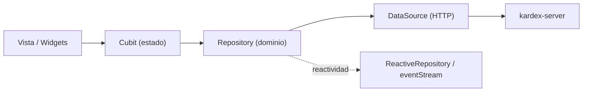

# Convenciones de Código (`kardex_app_front`)

Reglas para **todo cambio** en el frontend. Complementa a [`project_index.md`](./project_index.md) (arquitectura) y [`diseno_e_identidad_visual.md`](./diseno_e_identidad_visual.md) (identidad visual).

---

## 1. Capas y dependencias



| Capa | Ubicación | Responsabilidad | Prohibido |
| :--- | :--- | :--- | :--- |
| Modelo | `packages/kardex_business/lib/src/domain/models/` | DTO inmutable con `fromJson`, `toJson`, `copyWith`. | Lógica de red o estado mutable. |
| DataSource | `packages/kardex_business/lib/src/data/` | Petición HTTP y retorno de `Map<String, dynamic>`. | Conocer modelos de dominio. |
| Repository | `packages/kardex_business/lib/src/domain/repositories/` | Mapear JSON a modelos, caché en memoria y reactividad. | Hacer HTTP directo (usa el DataSource). |
| Cubit | `lib/src/modules/.../cubit/` o `lib/cubits/` | Estado de la vista y orquestación de casos de uso. | Llamar DataSources o hacer HTTP. |
| Vista | `lib/src/modules/.../` o `lib/widgets/` | Render declarativo y consumo de cubits. | Lógica de negocio. |

> **La capa de datos/dominio NO está en `lib/src/`.** Vive en `packages/kardex_business/lib/src/`. `lib/src/domain/` está vacío y `lib/src/data/` no existe.

---

## 2. Nombrado

| Elemento | Convención | Ejemplo |
| :--- | :--- | :--- |
| Archivos | `snake_case` | `credit_notes_screen.dart` |
| Clases | `PascalCase` | `CreditNotesCubit` |
| DataSources | `<nombre>_data_source.dart` / `<Nombre>DataSource` | `ClientsDataSource` |
| Repositorios | `<nombre>_repository.dart` / `<Nombre>Repository` | `ClientsRepository` |
| Cubits | `<nombre>_cubit.dart` + `<nombre>_state.dart` | `WriteExpenseCubit` |
| Vistas | `<nombre>_screen.dart` | `ExpenseListScreen` |
| Widgets | `<nombre>_widget.dart` o componente | `NearExpirationBanner` |
| Rutas | `kebab-case` en `route_names.dart` | `credit-notes` |

Los archivos y carpetas usan `snake_case`; las clases y widgets, `PascalCase`.

---

## 3. Modelos

- Viven en `packages/kardex_business`.
- Son inmutables y exponen `fromJson`, `toJson` y `copyWith`.
- Validan tipos al construir (no dejan pasar `dynamic` al resto de la app).
- Los campos viajan en `camelCase` porque el backend los expone así.
- Dinero en **centavos (`int`)** y fechas en **milisegundos (`int`)**, igual que el backend.

```dart
final invoice = InvoiceInDb.fromJson(json);
final updated = invoice.copyWith(status: 'paid');
```

---

## 4. DataSources

- Clase con `with HttpService` (no singleton manual; se instancian en `lib/provider_container.dart`).
- Usan `HttpTools.generateUri(endpoint, queryParameters: ...)` y `HttpTools.generateAuthHeaders()`.
- Retornan `Map<String, dynamic>`; **no** construyen modelos.
- Mantén un `_endpoint` privado por entidad.

```dart
class ClientsDataSource with HttpService {
  final _clientEndpoint = "/clients";

  Future<Map<String, dynamic>> getClients(Map<String, String> params) async {
    final uri = HttpTools.generateUri(_clientEndpoint, queryParameters: params);
    return getQuery(uri, headers: HttpTools.generateAuthHeaders());
  }
}
```

---

## 5. Repositorios y reactividad

- Reciben el DataSource por constructor.
- Mapean JSON a modelos y mantienen caché en memoria cuando aporta valor.
- Para notificar cambios a otros cubits, usa el mixin `ReactiveRepository<T>`:

```dart
class CreditNotesRepository with ReactiveRepository<CreditNoteInDb> {
  void markUpdated(CreditNoteInDb note) => notifyItemUpdated(note);
}
```

- Los cubits de lectura se suscriben a `eventStream` para refrescar sin recargar todo.
- No guardes estado global mutable en el repositorio sin necesidad; el cubit es el dueño del estado de vista.

---

## 6. Cubits

- Extienden `Cubit<TState>` y declaran estados `sealed` (`Initial`, `Loading`, `Success`, `Error`) cuando aplica.
- Reciben repositorios por constructor o vía `context.read<TRepository>()` / `getIt`.
- Nunca hacen HTTP ni conocen DataSources.
- Cierran suscripciones y streams en `close()`.
- Para permisos, consulta `AccessManager` o envuelve la UI en `RolePermissionGate`.

---

## 7. Vistas y responsive

- Widgets declarativos (`StatelessWidget` preferido).
- Separa por plataforma en `web/`, `mobile/`, `tablet/`, `desktop/` cuando la complejidad lo justifique.
- Usa las extensiones de `lib/src/tools/extensiones.dart`:
  - `isMobile()` → `< 600 dp`
  - `isTablet()` → `600–839 dp`
  - `isDesktop()` → `>= 840 dp`
- Reglas móviles canónicas (ver [`diseno_e_identidad_visual.md`](./diseno_e_identidad_visual.md)):
  - Padding perimetral de `4 px`.
  - Lista continua tipo Bento (`Card` único, `Divider`, `RowColorTool`).
  - Totales en `BottomAppBar` fijo.
  - Filtros colapsados por defecto.
  - Creación con `FloatingActionButton.extended`, **no** en `AppBar.actions`.

---

## 8. Identidad visual

Resumen de las reglas que más se rompen:

1. Fondo global `Colors.indigo.shade50`; **prohibido** forzar blanco plano en `Scaffold`.
2. Tarjetas y tablas en blanco puro.
3. `AppBar` con `ColourPalette.primary` (`#072A3C`) y texto/iconos blancos.
4. Botones críticos con `CustomSlider` (slide to confirm).
5. Confirmaciones destructivas con diálogo y motivo cuando aplique.

El detalle completo está en [`diseno_e_identidad_visual.md`](./diseno_e_identidad_visual.md).

---

## 9. Navegación y atajos

- Rutas centralizadas en `lib/config/app_router.dart` y nombres en `lib/constants/route_names.dart`.
- No uses strings de ruta sueltos; usa `RouteNames` / `goNamed`.
- La navegación post-login se resuelve con `NavigationTool.getNavigationAuthenticatedDestination`.
- Atajos globales registrados en `lib/constants/shortcut_registry.dart` y `lib/cubits/shortcuts/`.
- La guía completa está en [`sistema_navegacion.md`](./sistema_navegacion.md).

---

## 10. Impresión

- Servicio: `lib/src/services/thermal_printer_service.dart`.
- Impresoras por documento: `lib/src/tools/printers/` (`invoice_printer.dart`, `receipt_printer.dart`, etc.).
- Plantillas PDF: `lib/widgets/pdf/`.
- No dupliques lógica de conexión Bluetooth/USB en pantallas.
- Detalle en [`sistema_impresion_termica.md`](./sistema_impresion_termica.md).

---

## 11. Ramas `main` y `lite`

**Antes de tocar código, identifica la edición:**

```powershell
git branch --show-current   # main | lite
```

También puedes verificar `applicationId` en `android/app/build.gradle.kts` (`...neptuno_system` vs `...neptuno_system_lite`).

Reglas:

- Todo cambio en `main` debe evaluarse para `lite` **antes** de cerrar la tarea.
- Código compartido (modelos, data sources, repositories, `kardex_business`, widgets comunes): entra por `main` y se sincroniza con `git merge main` en `lite`.
- UI/arquitectura exclusiva de `lite`: se implementa en `lite`.
- Nunca se mergea `lite` completo hacia `main`.
- **Implementado ≠ registrado ≠ expuesto.** Una ruta en `app_router.dart` puede estar dentro de `/* ... */`. Confirma en `lib/src/modules/home/data/home_modules_registry.dart` si la pantalla se muestra.
- En `lite`, `product-movements`, `product-price-catalog` y `/advanced-tools` están comentadas; `commercial-product-movements` está activa pero no expuesta.
- Reglas de negocio y tabla verificada: [`ramas_main_vs_lite.md`](./ramas_main_vs_lite.md).

**Checklist de edición:**

- [ ] ¿Identifiqué la edición activa?
- [ ] ¿El cambio aplica a la otra edición? (sí / no / parcial)
- [ ] ¿Definí si es compartido, lite-only o no aplica?
- [ ] ¿La ruta nueva quedó registrada **y** expuesta en el Home?
- [ ] ¿Actualicé la documentación de diferencias si cambió la exposición?

---

## 12. Lints, formato y tests

- `analysis_options.yaml` incluye `flutter_lints` y exige `prefer_const_constructors`.
- Ancho de línea: `120`. Respeta el formato del proyecto.
- No silencies lints sin justificación.
- Verificación mínima:

```powershell
flutter analyze
flutter test
```

Para un módulo concreto:

```powershell
flutter analyze lib/src/modules/<modulo>
```

---

## 13. Checklist rápida

- [ ] ¿El código está en la capa correcta (package vs app)?
- [ ] ¿El modelo tiene `fromJson` / `toJson` / `copyWith`?
- [ ] ¿El cubit no hace HTTP?
- [ ] ¿La vista usa las extensiones de responsive?
- [ ] ¿Se respetan las reglas visuales (fondo, tarjetas, FAB)?
- [ ] ¿El cambio aplica también a `lite`? ¿Quedó documentado?
- [ ] ¿Pasan `flutter analyze` y `flutter test`?
