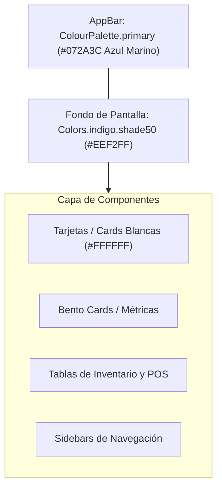

# Identidad Visual y Guía de Estilos: Fondos y Jerarquía Visual (`wiki/diseno_e_identidad_visual.md`)

Este documento define la **identidad visual oficial** de **Kardex App** (**Neptuno App**), estableciendo las reglas arquitectónicas de color, contraste y elevación de componentes para garantizar una experiencia cohesiva en todas las plataformas (Desktop, Tablet y Mobile).

---

## 1. La Paleta de Identidad y Regla de Oro

El sistema se fundamenta en un contraste de alta legibilidad y descanso visual entre una **superficie global fría y suave** y **componentes de primer plano blancos y limpios**:

### 1.1. Tokens Principales (`lib/config/app_theme.dart`)

| Elemento | Valor / Token | Propósito Visual |
| :--- | :--- | :--- |
| **Fondo Global (`scaffoldBackgroundColor`)** | `Colors.indigo.shade50` (`#EEF2FF` / Índigo Suave) | Proporciona una base uniforme, suave y libre de destellos cegadores que delimita naturalmente cada tarjeta y módulo. |
| **Cabecera Principal (`appBarTheme.backgroundColor`)** | `ColourPalette.primary` (`#072A3C` / Azul Marino Oscuro) | Aporta seriedad y jerarquía ejecutiva en la parte superior de cada vista. Texto e iconos en blanco. |
| **Acentos Primarios** | `ColourPalette.primaryVariant` (`#3B62A1` / Azul Clásico) | Botones primarios de confirmación, links y estados activos. |
| **Superficie de Tarjetas (`Cards`)** | `Colors.white` (`#FFFFFF`) | Toda tarjeta Bento, fila o tabla de datos debe ser blanca pura para crear el contraste con el fondo índigo suave. |

---

## 2. La Regla de Oro: Erradicación de Fondos Blancos Planos

> [!IMPORTANT]
> **Prohibido forzar fondos blancos planos en `Scaffold`, `Container` raíz o listas principales.**
> 
> Históricamente, algunos módulos forzaban `backgroundColor: Colors.white`, `Color(0xFFF8FAFC)` o `AppThemeTokens.surfaceLight`. Esto aplanaba la interfaz, eliminando la profundidad visual de las tarjetas y borrando la identidad de la aplicación.

### Reglas Obligatorias para Desarrolladores:
1. **El `Scaffold` nunca define `backgroundColor`**: Salvo en pantallas modales de bloqueo extremo o terminales especializados, los `Scaffold` deben dejar que el tema inyecte `Theme.of(context).scaffoldBackgroundColor` (`Colors.indigo.shade50`).
2. **Cero `Container` o `ColoredBox` con fondo forzado en el body**: No envuelvas el `body` de las pantallas en `ColoredBox(color: AppThemeTokens.surfaceLight)` ni `Container(color: const Color(0xFFF8FAFC))`. Deja que el contenido fluya directamente sobre el fondo del `Scaffold`.
3. **Contraste de Tarjetas y Secciones**: El contenido funcional (métricas, formularios, encabezados de sucursal, tablas) se agrupa en tarjetas `Card`, contenedores `BoxDecoration(color: Colors.white, borderRadius: ..., border: Border.all(color: Colors.grey.shade200))` o tarjetas Bento con sombra suave (`AppThemeTokens.subtleCardShadow()`).

---

## 3. Módulos Estandarizados con la Identidad Visual

### 3.1. Panel Administrativo (`lib/admin_panel/admin_panel_screen.dart`)
- **Scaffold:** Hereda `Colors.indigo.shade50`.
- **Componentes:**
  - `_WelcomeHeader`: Tarjeta blanca destacada con avatar índigo tintado y detalles de la sucursal activa.
  - `_SalesSummary`: Tarjetas métricas blancas con valores monetarios en verde y azul.
  - `_SalesChartCard`: Gráfico de 7 días sobre tarjeta blanca elevada.
  - `AppActionTile`: Accesos rápidos en tarjetas blancas con iconos redondeados de acento funcional.

### 3.2. Conmutador Multi-Sucursal (`lib/src/modules/multi_branch_home/multibranch_home_screen.dart`)
- **Fondo:** `_PageBackground` utiliza `SizedBox.expand` sin color forzado, extendiendo el índigo suave por todo el viewport.
- **Componentes:** El hero principal, el selector de sucursales y las tarjetas de empresa flotan limpiamente sobre la superficie índigo.

### 3.3. Home Principal (`lib/src/modules/home/`)
- **Desktop (`home_desktop.dart`):**
  - Barra lateral (`DesktopModuleSidebar`) en blanco puro delimitada por borde derecho (`Colors.grey.shade200`).
  - Panel inicial (`DesktopInitialPanel`) y panel de submenús (`DesktopSubmenuPanel`): Sin fondos grisáceos forzados; descansan directamente sobre el fondo índigo suave, permitiendo que `_BranchHero`, `NearExpirationBanner` y las tarjetas de submenú (`DesktopSubmenuCard`) ofrezcan relieve visual inmediato.
- **Mobile y Tablet (`home_mobile.dart`, `home_tablet.dart`):**
  - Menú de tarjetas táctiles y banner de vencimientos descansan sobre el fondo índigo suave, eliminando el deslumbramiento del blanco plano.

### 3.4. Solicitud de Ajuste de Inventario (`adjustment_request`)
- **Formulario Web y Listados:** Fondo índigo suave, AppBar azul marino, cabecera de 2 tarjetas blancas estándar y tabla de productos con alternancia de colores (`Colors.white` vs `Colors.grey.shade200`).
- **Mobile:** Fondo índigo con tarjetas Bento de productos y cabecera estándar.

### 3.5. Módulo de Gastos (`expenses`)
- **Menú, Listados y Reportes:** Eliminación de AppBars blancos y fondos planos; adopción plena del AppBar `ColourPalette.primary` y fondo índigo suave.

---

## 4. Checklist para Nuevas Pantallas

Al crear una nueva pantalla o refactorizar una existente:
- [ ] ¿El `Scaffold` omite la propiedad `backgroundColor` para usar el fondo índigo suave del tema?
- [ ] ¿El `AppBar` utiliza el estilo por defecto del tema (azul marino `ColourPalette.primary` con iconos blancos)?
- [ ] ¿Las secciones de datos y formularios están agrupadas en tarjetas blancas (`Colors.white`) con bordes sutiles o sombras suaves?
- [ ] ¿Se evitó el uso de `AppThemeTokens.surfaceLight` o `Color(0xFFF8FAFC)` como fondo de página?
