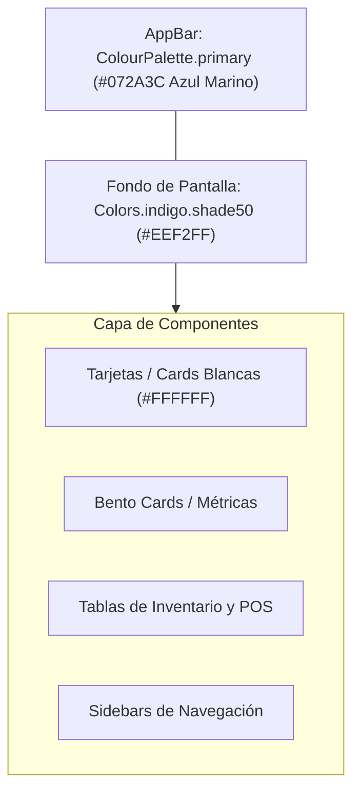
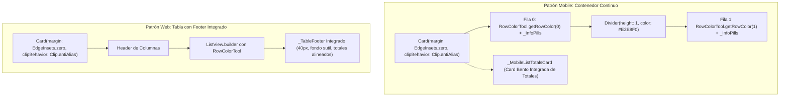

# Identidad Visual y Guía de Estilos: Fondos y Jerarquía Visual (`wiki/diseno_e_identidad_visual.md`)

Este documento define la **identidad visual oficial** de **Kardex App** (**Neptuno App**), estableciendo las reglas arquitectónicas de color, contraste y elevación de componentes para garantizar una experiencia cohesiva en todas las plataformas (Desktop, Tablet y Mobile).

---

## 1. La Paleta de Identidad y Regla de Oro

El sistema se fundamenta en un contraste de alta legibilidad y descanso visual entre una **superficie global fría y suave** y **componentes de primer plano blancos y limpios**:

### 1.1. Tokens Principales (`lib/config/app_theme.dart`)

| Elemento | Valor / Token | Propósito Visual |
| :--- | :--- | :--- |
| **Fondo Global (`scaffoldBackgroundColor`)** | `Colors.indigo.shade50` (`#EEF2FF` / Índigo Suave) | Proporciona una base uniforme, suave y libre de destellos cegadores que delimita naturalmente cada tarjeta y módulo. |
| **Cabecera Principal (`appBarTheme.backgroundColor`)** | `ColourPalette.primary` (`#072A3C` / Azul Marino Oscuro) | Aporta seriedad y jerarquía ejecutiva en la parte superior de cada vista. Texto e iconos en blanco. |
| **Acentos Primarios** | `ColourPalette.primaryVariant` (`#3B62A1` / Azul Clásico) | Botones primarios de confirmación, links y estados activos. |
| **Superficie de Tarjetas (`Cards`)** | `Colors.white` (`#FFFFFF`) | Toda tarjeta Bento, fila o tabla de datos debe ser blanca pura para crear el contraste con el fondo índigo suave. |

---

## 2. La Regla de Oro: Erradicación de Fondos Blancos Planos

> [!IMPORTANT]
> **Prohibido forzar fondos blancos planos en `Scaffold`, `Container` raíz o listas principales.**
> 
> Históricamente, algunos módulos forzaban `backgroundColor: Colors.white`, `Color(0xFFF8FAFC)` o `AppThemeTokens.surfaceLight`. Esto aplanaba la interfaz, eliminando la profundidad visual de las tarjetas y borrando la identidad de la aplicación.

### Reglas Obligatorias para Desarrolladores:
1. **El `Scaffold` nunca define `backgroundColor`**: Salvo en pantallas modales de bloqueo extremo o terminales especializados, los `Scaffold` deben dejar que el tema inyecte `Theme.of(context).scaffoldBackgroundColor` (`Colors.indigo.shade50`).
2. **Cero `Container` o `ColoredBox` con fondo forzado en el body**: No envuelvas el `body` de las pantallas en `ColoredBox(color: AppThemeTokens.surfaceLight)` ni `Container(color: const Color(0xFFF8FAFC))`. Deja que el contenido fluya directamente sobre el fondo del `Scaffold`.
3. **Contraste de Tarjetas y Secciones**: El contenido funcional (métricas, formularios, encabezados de sucursal, tablas) se agrupa en tarjetas `Card`, contenedores `BoxDecoration(color: Colors.white, borderRadius: ..., border: Border.all(color: Colors.grey.shade200))` o tarjetas Bento con sombra suave (`AppThemeTokens.subtleCardShadow()`).

---

## 3. Módulos Estandarizados con la Identidad Visual

### 3.1. Panel Administrativo (`lib/admin_panel/admin_panel_screen.dart`)
- **Scaffold:** Hereda `Colors.indigo.shade50`.
- **Componentes:**
  - `_WelcomeHeader`: Tarjeta blanca destacada con avatar índigo tintado y detalles de la sucursal activa.
  - `_SalesSummary`: Tarjetas métricas blancas con valores monetarios en verde y azul.
  - `_SalesChartCard`: Gráfico de 7 días sobre tarjeta blanca elevada.
  - `AppActionTile`: Accesos rápidos en tarjetas blancas con iconos redondeados de acento funcional.

### 3.2. Conmutador Multi-Sucursal (`lib/src/modules/multi_branch_home/multibranch_home_screen.dart`)
- **Fondo:** `_PageBackground` utiliza `SizedBox.expand` sin color forzado, extendiendo el índigo suave por todo el viewport.
- **Componentes:** El hero principal, el selector de sucursales y las tarjetas de empresa flotan limpiamente sobre la superficie índigo.

### 3.3. Home Principal (`lib/src/modules/home/`)
- **Desktop (`home_desktop.dart`):**
  - Barra lateral (`DesktopModuleSidebar`) en blanco puro delimitada por borde derecho (`Colors.grey.shade200`).
  - Panel inicial (`DesktopInitialPanel`) y panel de submenús (`DesktopSubmenuPanel`): Sin fondos grisáceos forzados; descansan directamente sobre el fondo índigo suave, permitiendo que `_BranchHero`, `NearExpirationBanner` y las tarjetas de submenú (`DesktopSubmenuCard`) ofrezcan relieve visual inmediato.
- **Mobile y Tablet (`home_mobile.dart`, `home_tablet.dart`):**
  - Menú de tarjetas táctiles y banner de vencimientos descansan sobre el fondo índigo suave, eliminando el deslumbramiento del blanco plano.

### 3.4. Solicitud de Ajuste de Inventario (`adjustment_request`) — ⭐ Módulo de Referencia de Diseño (Estándar Canónico)
Este módulo representa el **estándar de oro visual y arquitectónico** de la aplicación, implementando a la perfección tanto en Web como en Mobile el **Patrón Bento Continuo**, las pastillas informativas `_InfoPill` y los pies de totales integrados.

---

## 4. El Patrón Bento Continuo y Listas de Alta Densidad (Estándar Oficial)

A partir del rediseño integral de **Solicitudes de Ajuste (`adjustment_request`)**, toda lista, tabla y vista de detalle en la aplicación debe regirse por los siguientes pilares de diseño:

### 4.1. Regla 1: Contenedores Continuos en Móvil (No Tarjetas Flotantes Sueltas)
- **Prohibido:** Renderizar listas de tarjetas flotantes con sombras individuales y separación de `SizedBox(height: 10)`. Esto satura la pantalla móvil y genera una sensación de interfaz desordenada y fragmentada.
- **Obligatorio:**
  - Encapsular la colección completa de ítems dentro de un **único** `Card(margin: EdgeInsets.zero, clipBehavior: Clip.antiAlias)`.
  - Conectar los ítems de forma contigua, separados únicamente por un divisor sutil `const Divider(height: 1, thickness: 1, color: Color(0xFFE2E8F0))`.
  - Aplicar alternancia sutil de color de fondo con `RowColorTool.getRowColor(index)` para distinguir los ítems adyacentes de forma natural.

### 4.2. Regla 2: Pastillas Bento Informativas (`_InfoPill` / `_ListInfoPill`)
- En lugar de texto plano desestructurado o columnas desalineadas, la información métrica (existencias, conteos, diferencias, sobrantes, faltantes y totales) debe mostrarse en **pastillas Bento compactas**:
  - Contenedor con fondo blanco (`Colors.white`), esquinas redondeadas (`BorderRadius.circular(8)`) y borde sutil (`Border.all(color: Colors.grey.shade200)`).
  - Título/Etiqueta superior en 10px con `fontWeight: FontWeight.w600` y color neutral (`AppThemeTokens.neutral`).
  - Valor destacado inferior en 12–13px (`FontWeight.w700` o `w900`), con color semántico:
    - **Verde (`Colors.green.shade700` / `AppThemeTokens.success`):** Sobrantes, entradas, existencias favorables.
    - **Rojo (`Colors.red.shade700` / `AppThemeTokens.danger`):** Faltantes, salidas, mermas.
    - **Índigo / Oscuro (`Color(0xFF0F172A)`):** Totales neutros o positivos.

### 4.3. Regla 3: Tarjetas Bento de Totales en Móvil (`_TotalsCard` / `_MobileListTotalsCard`)
- **Prohibido:** Colocar barras de totales flotantes genéricas (`TotalsBar`) desalineadas fuera del contenedor o con diseño plano.
- **Obligatorio:** Usar una tarjeta Bento limpia `Card(margin: EdgeInsets.zero)` con padding de 12px que agrupe:
  - Total de ítems o documentos (fila superior con etiqueta gris y valor bold).
  - Importes parciales (Sobrante en verde, Faltante en rojo).
  - Divisor horizontal sutil `const Divider(height: 1)`.
  - Total Neto en tipografía grande (15–16px bold) con color semántico según balance.

### 4.4. Regla 4: Pie de Tabla Integrado en Web (`_TableFooter`)
- **Prohibido:** Renderizar barras de totales (`_ListBottomSummary`) flotando en la pantalla por debajo de la tabla.
- **Obligatorio:** Incrustar el pie de totales **directamente dentro del `Card` de la tabla**:
  - Altura fija de 40px con fondo suave `Colors.grey.shade50`.
  - Conteo de registros a la izquierda (`Total Solicitudes: X` o `Total Productos: X`).
  - Totales monetarios a la derecha con etiquetas semánticas y el **Total Neto** en 15–16px bold.

### 4.5. Regla 5: Cabecera Estándar de 2 Tarjetas Bento en Web (160px de alto)
- Toda pantalla de formulario o detalle en Web debe estructurar su encabezado en dos tarjetas Bento de 160px de altura:
  1. **Tarjeta Fija Izquierda (380px de ancho):** Metadatos clave organizados verticalmente (Sucursal en `TitleTextField`, `DateFieldSelector` o fecha formateada, y Creador).
  2. **Tarjeta Flexible Derecha (`Expanded`):** Fila superior con identificador de documento, chip de estado y barra de acciones (`ElevatedCtrlButton`); y fila inferior con campo de observaciones (`maxLines: 2`) y paneles de trazabilidad de estados.

---

## 5. Checklist para Nuevas Pantallas

Al crear una nueva pantalla o refactorizar una existente:
- [ ] ¿El `Scaffold` omite la propiedad `backgroundColor` para usar el fondo índigo suave del tema?
- [ ] ¿El `AppBar` utiliza el estilo por defecto del tema (azul marino `ColourPalette.primary` con iconos blancos)?
- [ ] ¿Las listas móviles están agrupadas en un único `Card` continuo sin márgenes exteriores entre filas y con `RowColorTool`?
- [ ] ¿Las métricas e importes móviles usan el patrón de pastillas Bento `_InfoPill`?
- [ ] ¿Los totales móviles están estructurados en una tarjeta Bento integrada en lugar de barras flotantes?
- [ ] ¿Las tablas Web integran el pie de totales (`_TableFooter`) dentro del mismo `Card` de la tabla?
- [ ] ¿Los formularios y detalles Web emplean la cabecera estándar de 2 tarjetas Bento de 160px?
