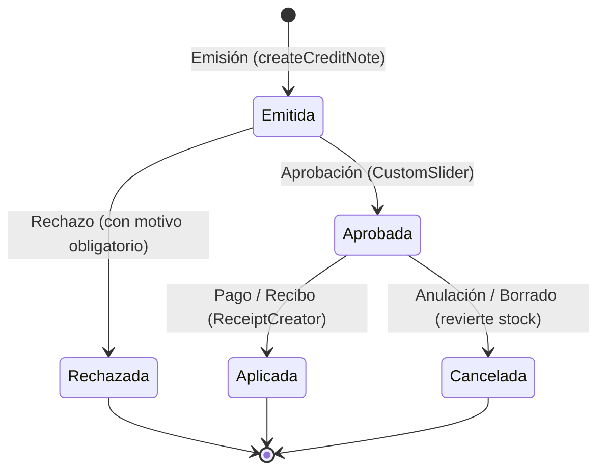

# Documentación del Módulo: Notas de Crédito (`credit_notes`)

El módulo **Notas de Crédito** gestiona la emisión, auditoría y aplicación de notas de crédito en `kardex_app_front`. Diseñado para evolucionar y reemplazar progresivamente las devoluciones tradicionales, permite procesar retornos de mercancía (con reingreso físico al inventario) y concesiones de saldos a favor por monto (por bonificación o acuerdo comercial), integrándose de forma transparente con el flujo de cuentas por cobrar y recibos de pago.

Además, este módulo introduce la implementación canónica del **Repositorio Reactivo (`ReactiveRepository`)** en el frontend.

---

## 1. Arquitectura y Estructura de Archivos

```text
lib/
├── src/
│   ├── cubits/credit_note_cubit/
│   │   ├── read_credit_notes_cubit.dart    # Cubit de lectura suscrito al eventStream
│   │   ├── read_credit_notes_state.dart    # Estados sellados + changelog (new, updated, deleted)
│   │   ├── write_credit_notes_cubit.dart   # Cubit de emisión/escritura (reset a Initial tras éxito)
│   │   └── write_credit_notes_state.dart
│   └── modules/commercial/
│       ├── credit_notes/
│       │   ├── credit_notes_screen.dart    # Pantalla principal con filtros y búsqueda reactiva
│       │   └── dialogs/
│       │       └── create_credit_note_dialog.dart # Diálogo interactivo (devolución y monto)
│       └── pending_invoice/                # Integración con cobranza y recibos
│           ├── cubit/read_pending_invoice_cubit.dart # Carga notas confirmadas del cliente
│           ├── web/receipt_creator/
│           │   ├── fast_receipt_logic.dart # Asignación de abonos con notas de crédito
│           │   ├── receipt_creator_screen.dart # Liquidación/abono aplicando appliedCreditNotes
│           │   └── modals/partial_payment_modal.dart # Desglose de notas aplicadas por factura
│           └── widget/invoice_devolution_tile.dart # Reflejo de notas vinculadas y acceso a visor
└── widgets/dialogs/viewers/
    └── credit_note_viewer.dart             # Visor modal de comprobante de nota de crédito
```

En la capa de negocio (`packages/kardex_business`):
```text
packages/kardex_business/lib/src/
├── domain/models/credit_note/
│   └── credit_note.dart                    # Modelos inmutables (CreditNoteInDb, BaseCreditNote, etc.)
├── domain/query_params/
│   └── credit_note_query_params.dart       # Parámetros de filtrado
├── domain/repositories/
│   └── credit_notes_repository.dart        # Repositorio reactivo con ReactiveRepository
├── data/
│   └── credit_note_data_source.dart        # Llamadas REST vía HttpService
└── tools/reactive_repo/
    └── reactive_repository.dart            # Mixin canónico ReactiveRepository<T> y RepoEvent<T>
```

---

## 2. Patrón de Repositorio Reactivo (`ReactiveRepository`)

Siguiendo el estándar de arquitectura Onion de OKF (`lab_project/okf-style-imp`):

```mermaid
flowchart TD
    Dialog["CreateCreditNoteDialog (WriteCreditNoteCubit)"] -->|createCreditNote()| Repo["CreditNotesRepository with ReactiveRepository"]
    Repo -->|Llamada HTTP POST| API["Backend Server (FastAPI)"]
    API -->|CreditNoteInDb| Repo
    Repo -->|notifyItemCreated(item)| Stream["eventStream (StreamController.broadcast)"]
    Stream -->|RepoItemCreated| ReadCubit["ReadCreditNoteCubit (suscrito en constructor)"]
    ReadCubit -->|markCreditNoteCreated()| State["ReadCreditNoteSuccess (items + changelog)"]
    State -->|Rebuild automático| Screen["CreditNotesScreen (UI)"]
```

### Reglas Clave:
1. **Sin Caché en el Repositorio:** El repositorio no almacena listas en memoria; la única fuente de verdad es el estado de `ReadCreditNoteCubit`.
2. **Desacoplamiento Total:** Los WriteCubits efímeros (instanciados dentro de diálogos modales) se comunican mediante el `eventStream` del repositorio sin necesidad de acoplamiento por contexto (`BlocListener`).
3. **Manejo del Ciclo de Vida:** La suscripción se abre en el constructor de `ReadCreditNoteCubit` y se cancela estrictamente en su método `close()`:

```dart
class ReadCreditNoteCubit extends Cubit<ReadCreditNoteState> {
  ReadCreditNoteCubit(this._repository) : super(ReadCreditNoteInitial()) {
    _subscription = _repository.eventStream.listen(_handleRepoEvent);
  }

  final CreditNotesRepository _repository;
  StreamSubscription<RepoEvent<CreditNoteInDb>>? _subscription;

  void _handleRepoEvent(RepoEvent<CreditNoteInDb> event) {
    switch (event) {
      case RepoItemCreated(:final item):
        markCreditNoteCreated(item);
      case RepoItemUpdated(:final item):
        markCreditNoteUpdated(item);
      case RepoItemDeleted(:final item):
        markCreditNoteDeleted(item);
    }
  }

  @override
  Future<void> close() async {
    await _subscription?.cancel();
    return super.close();
  }
}
```

---

## 3. Modalidades de Emisión en la UI

El diálogo interactivo [`create_credit_note_dialog.dart`](file:///c:/Users/sytru/Developer/Projects/kardex_app/kardex_app_front/lib/src/modules/commercial/credit_notes/dialogs/create_credit_note_dialog.dart) ofrece un conmutador de tipo:

### 3.1. Por Devolución (`CreditNoteType.devolution`)
- **Búsqueda en Vivo:** Permite buscar una factura emitida por su número correlativo (`docNumber`).
- **Selección de Productos:** Despliega los ítems facturados con controles numéricos para elegir cuántas unidades se devuelven (con tope en la cantidad originalmente facturada).
- **Cálculo Automático:** Calcula en tiempo real el importe total en base a los precios unitarios de la factura original.
- **Resultado:** Reingresa la mercancía al inventario y genera la nota confirmada.

### 3.2. Por Monto (`CreditNoteType.amount`)
- **Asignación de Cliente:** Abre el selector de clientes registrados del sistema.
- **Importe Libre:** Permite ingresar un monto monetario en moneda local.
- **Motivo Detallado Obligatorio:** Requiere documentar la razón comercial de la bonificación o descuento otorgado.
- **Resultado:** No afecta inventario físico; queda disponible para amortizar cuentas por cobrar.

---

## 4. Trazabilidad en Visores, Movimientos y Eliminación

1. **Visor Dedicado (`credit_note_viewer.dart`):**
   - Ubicado de manera canónica en [`lib/widgets/dialogs/viewers/credit_note_viewer.dart`](file:///c:/Users/sytru/Developer/Projects/kardex_app/kardex_app_front/lib/widgets/dialogs/viewers/credit_note_viewer.dart) junto al resto de visores (`invoice_viewer.dart`, `receipt_viewer.dart`, `devolution_viewer.dart`, etc.).
   - Modal responsive estilo Bento/Voucher que detalla folio, cliente, fecha, sucursal, creador, desglose de ítems devueltos o motivo de monto, e información de aplicación (recibo asociado y fecha).
   - **Acción Destructiva en BottomAppBar:** El botón `"Borrar Nota de Crédito"` se ubica centrado en un `BottomAppBar` al pie de la pantalla y **se oculta por completo si la nota ya está aplicada** (`creditNote.status == CreditNoteStatus.applied`), manteniendo el `AppBar` limpio únicamente con las acciones de PDF, Compartir e Imprimir.
2. **Eliminación y Reversión Reactiva:**
   - La eliminación de notas confirmadas o abiertas se ejecuta desde el visor con diálogo deslizante de confirmación (`slideToConfirmDeleteActionDialog`), evitando borrados accidentales desde el listado general.
   - Al confirmarse el borrado, el backend revierte automáticamente el stock reingresado si era por devolución, y `CreditNotesRepository` notifica via `notifyItemDeleted`, actualizando instantáneamente la lista en memoria de `ReadCreditNoteCubit` sin recargar la pantalla.
3. **Kárdex de Productos:**
   - Conectado en [`show_doc_viewer.dart`](file:///c:/Users/sytru/Developer/Projects/kardex_app/kardex_app_front/lib/src/tools/show_doc_viewer.dart). Al presionar sobre un movimiento de kárdex con subtipo `credit_note`, se abre directamente el visor de la nota.
4. **Estado de Cuenta de Clientes:**
   - Conectado en [`movement_mobile_row.dart`](file:///c:/Users/sytru/Developer/Projects/kardex_app/kardex_app_front/lib/src/modules/finance/client_movements/view/widgets/movement_mobile_row.dart), visualizando la etiqueta `"Nota de Crédito"` en morado y permitiendo auditar el documento desde la lista de transacciones.

---

## 5. Integración con Cuentas por Cobrar y Recibos (`pending_invoice`)

En compras a crédito, las notas de crédito confirmadas funcionan como saldo a favor del cliente:

1. **Carga Optimizada (Composite Router):** `ReadPendingInvoiceCubit` utiliza `compositeRepository.getClientPendingInvoices(clientId, branchId)` para consultar en un único roundtrip HTTP las facturas pendientes, devoluciones activas y notas de crédito confirmadas junto al resumen canónico de importes.
2. **Tile de Resumen Bento UI (`CreditNotesSummaryTile`):** Muestra de forma destacada en la parte superior el total de notas a favor del cliente con píldora morada, lista expandible de notas individuales e hipervínculo para abrir el visor de cada una.
3. **Visualización en Facturas y Visor de Acreditación:** 
   - `InvoiceDevolutionTile` e `InvoiceAcreditViewer` deducen el saldo de notas vinculadas y permiten inspeccionar las notas aplicables.
4. **Restricción de Seguridad Estricta (Anti-Excedentes):**
   - Se valida en `FastReceiptLogic`, `ReceiptCreatorScreen` y `InvoiceAcreditViewer` que el monto acumulado de notas de crédito aplicadas nunca sobrepase la deuda neta de las facturas seleccionadas.
   - En caso de excederse, los botones de pago/liquidación se inhabilitan y se muestra una advertencia visual al cajero.
5. **Distribución Inteligente:** `FastReceiptLogic.allocateFastPayment()` aplica secuencialmente devoluciones vinculadas, notas vinculadas, notas por monto del cliente y fondos en efectivo.
6. **Liquidación y Abonos:** Al liquidar o abonar en `ReceiptCreatorScreen` y `PartialPaymentModal`, se genera el payload `CreateReceipt` con `appliedCreditNotes: list[AppliedCreditNote]`. El backend amortiza las facturas y cambia el estado de las notas a `applied`.

---

## 6. Ciclo de Vida y Flujo de Aprobación de Notas de Crédito

Las notas de crédito implementan un flujo de dos etapas para prevenir auto-aprobaciones inmediatas y garantizar el control de devoluciones e inventario:



### 6.1. Estados y Reglas de Negocio
1. **Emitida (`emitted`):**
   - Estado inicial al crear una nota de crédito.
   - **No afecta stock físico** ni crea transacciones de kárdex (si es por devolución).
   - **No descuenta saldos** en cuentas por cobrar ni en cobros rápidos.
   - En la factura original se muestra un aviso informativo sutil de nota pendiente de revisión, sin alterar el saldo deudor.
2. **Aprobada (`approved`):**
   - Transición ejecutada mediante `CustomSlider` ("Desliza para Aprobar") en `CreditNoteViewer`.
   - **Reingresa el stock físico** en inventario de la sucursal y genera el movimiento de kárdex (`type="entry", subtype="credit_note"`).
   - Se refleja con saldo descontado en la factura asociada (`InvoiceViewer` e `InvoiceAcreditViewer`), calculando el **Total Neto**.
   - Queda habilitada para ser aplicada como fondo de pago en `ReceiptCreatorScreen` y `FastReceiptLogic`.
   - Registra auditoría: `approvedBy` (usuario) y `approvedAt` (timestamp).
3. **Rechazada (`rejected`):**
   - Requiere ingresar obligatoriamente un motivo en diálogo modal.
   - No altera inventario ni cuentas por cobrar.
   - **Oculta por completo** en el visor de facturas y recibos para no generar ruido visual ni confusión.
   - Registra auditoría: `rejectedBy`, `rejectedAt` y `rejectionReason`.
4. **Aplicada (`applied`):**
   - Utilizada como medio de pago amortizando facturas en un recibo. Bloquea su edición o borrado.
5. **Cancelada (`cancelled`):**
   - Anulación desde el visor. Solo revierte stock si la nota se encontraba en estado `approved` o `confirmed`.

---

## 7. Reflejo en Facturas y Recibos de Pago

1. **Visor de Facturas (`invoice_viewer.dart` e `invoice_acredit_viewer.dart`):**
   - Filtra y **omite notas canceladas o rechazadas**.
   - Las notas aprobadas (`approved` / `confirmed`) se desglosan en color morado (`- $XX.XX`) con acceso directo a su comprobante mediante tap, recalculando el importe neto de la factura.
   - Las notas pendientes (`emitted`) muestran un badge informativo sin descontar saldo.
2. **Visor de Recibos (`receipt_viewer.dart`):**
   - Despliega la sección **"Notas de Crédito Aplicadas"** con folio, fecha, importe y enlace interactivo al visor de la nota.
   - En el pie de liquidación, desglosa: `Total Facturas`, `Devoluciones (-)`, `Notas de Crédito (-)` y `Total Recibo (Cobrado)`.
3. **Impresión de Tickets Térmicos (`receipt_printer.dart`):**
   - Imprime bloque con correlativo de las notas aplicadas y el descuento correspondiente en el resumen de totales (`N. Créd.: -$XX.XX`).
4. **Plantilla PDF Oficial A4 (`single_receipt_template.dart`):**
   - Incorpora tabla formal de notas de crédito aplicadas y fila de deducción en el cuadro de totales.

---

## 8. Pendientes y Roadmap Futuro de Aprobación

> [!NOTE] Deuda Técnica y Pendientes de Control de Acceso
> - **Aprobación Abierta Temporal:** Actualmente cualquier usuario autenticado con acceso al módulo puede aprobar o rechazar notas de crédito.
> - **Permiso Granular Planificado:** En próximas versiones se implementará el permiso explícito `RolePermission.APPROVE_CREDIT_NOTE` (y su contraparte en backend), restringiendo la aprobación a supervisores de sucursal o gerentes de crédito.

---

## 9. Navegación, Rutas y Permisos

- **Ruta GoRouter:** `/commercial/credit-notes` (nombre canónico: `RouteNames.creditNotes`).
- **Acceso:** Tarjeta de menú en [`commercial_menu_screen.dart`](file:///c:/Users/sytru/Developer/Projects/kardex_app/kardex_app_front/lib/src/modules/commercial/commercial_menu_screen.dart) con icono `assignment_return_rounded` y color de acento morado.
- **Permisos:** Protegido por `RolePermissionGate` requiriendo `CommercialSubModules.createCreditNote` o `CommercialSubModules.creditNoteHistory`.
