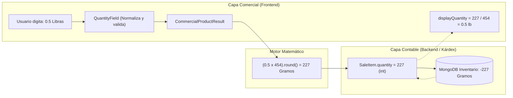
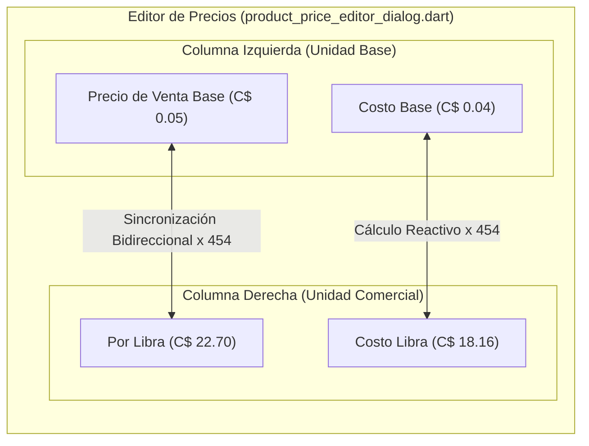

# Guía Maestra de Unidades de Medida y Conversiones (`unit_scales`)

La gestión de **Unidades de Medida y Escalas de Conversión (`UnitScale`)** en `kardex_app_front` y `kardex_business` es el núcleo que permite conciliar dos mundos dentro del sistema:
1. **La Rigurosidad Contable del Inventario:** Todo el inventario físico y los movimientos de kárdex en MongoDB se registran **estrictamente en números enteros (`int`) referidos a la Unidad Base Mínima Indivisible**.
2. **La Flexibilidad Comercial de Ventas y Compras:** En la operación diaria, los cajeros y vendedores necesitan transaccionar en unidades comerciales cotidianas (Libras, Kilogramos, Litros, Cajas, Docenas), incluyendo **fracciones decimales** (ej. $0.5$ lb, $1.25$ kg), sin introducir descalces de redondeo en el stock físico ni en la contabilidad.

---

## 1. Filosofía Arquitectónica: La Regla de Oro Contable

> [!IMPORTANT]
> **El Kárdex y el Inventario Físico son 100% Enteros (`int`):**
> En ningún lugar del backend (`kardex-server`) ni de la base de datos de MongoDB existen cantidades fraccionarias de existencias. La existencia (`currentStock`), existencias comprometidas (`promiseStock`) y movimientos transaccionales de kárdex (`SaleItem.quantity`, `ProductTransaction.quantity`) siempre representan **unidades base indivisibles mínimas**.

### ¿Por qué esta decisión de diseño?
- **Consistencia Atómica:** Evita errores de precisión en punto flotante (`IEEE 754`) que provocan desfases de centavos o fracciones residuales imposibles de descontar (ej. `0.000000000000001` de stock).
- **Simplicidad de Kárdex Transaccional:** Cada movimiento de inventario es una operación aritmética entera determinista.
- **Trazabilidad:** Cuando un cliente compra $0.5$ Libras de Arroz cuya unidad base es el Gramo (factor 454), el Kárdex descuenta exactamente:
  $$\text{Cantidad Base Físicamente Descontada} = (0.5 \times 454).\text{round}() = 227 \text{ Gramos}$$



---

## 2. Modelos de Dominio y Estructura de Datos

### 2.1. `ExtraUnit` (`packages/kardex_business`)
Representa una unidad de empaque o múltiplo superior respecto a la unidad base:
```dart
class ExtraUnit {
  final String name;          // Nombre de la unidad (ej. "Libra", "Kilogramo", "Caja")
  final int conversionFactor; // Factor multiplicador entero respecto a la base (ej. 454, 1000, 24)

  const ExtraUnit({
    this.name = '',
    this.conversionFactor = 1,
  });
}
```

### 2.2. Definición en Productos (`BaseProduct` / `ProductInDb`)
Cada ficha de producto almacena:
```dart
class BaseProduct {
  final String unitName;            // Unidad base indivisible (ej. "Gramo", "Mililitro", "Unidad")
  final List<ExtraUnit> extraUnits; // Lista de unidades comerciales adicionales
  final int defaultUnitIndex;       // Índice sugerido para venta: 0 = unitName, 1..N = extraUnits
  final int wholesaleUnitIndex;     // Índice sugerido para venta mayorista
  
  // Getters inteligentes de resolución
  String get defaultUnitName => defaultUnitIndex == 0 ? unitName : extraUnits[defaultUnitIndex - 1].name;
  int get defaultUnitFactor => defaultUnitIndex == 0 ? 1 : extraUnits[defaultUnitIndex - 1].conversionFactor;
}
```

### 2.3. Plantillas de Escalas (`UnitScaleInDb` / `BaseUnitScale`)
Permiten guardar en base de datos esquemas predefinidos reutilizables para aplicar a múltiples productos:
```dart
class BaseUnitScale {
  final String name;            // Nombre de la escala (ej. "Peso Estándar", "Cajas de Gaseosas")
  final String baseUnit;        // Unidad base (ej. "Gramo", "Unidad")
  final List<ExtraUnit> units;  // Unidades hijas con factores
  final int defaultUnitIndex;   // Sugerencia para ventas de mostrador
  final int wholesaleUnitIndex; // Sugerencia para ventas de mayoreo
}
```

---

## 3. Presets y Plantillas del Sistema (`UnitScalePresets`)

Para eliminar la fricción de configurar manualmente factores de conversión en cada producto nuevo, el sistema provee plantillas listas para usar en [unit_scale_presets.dart](file:///c:/Users/sytru/Developer/Projects/kardex_app/kardex_app_front/packages/kardex_business/lib/src/tools/unit_scale_presets.dart):

| Categoría Preset | Unidad Base | Unidades Extras y Factores Multiplicadores | Unidad Preferida |
| :--- | :--- | :--- | :--- |
| **Peso (Libras / Kilogramos)** | `Gramo` | `Onza` (x28), `Libra` (x454), `Kilogramo` (x1000) | Libra |
| **Peso Agrícola (Granos Básicos)** | `Gramo` | `Libra` (x454), `Arroba` (x11350), `Quintal` (x45400) | Libra |
| **Volumen / Líquidos** | `Mililitro` | `Litro` (x1000), `Galón` (x3785) | Litro |
| **Empaques (Docenas / Cajas)** | `Unidad` | `Media Docena` (x6), `Docena` (x12), `Caja (24)` (x24) | Docena |
| **Longitud / Telas y Ferretería** | `Centímetro` | `Metro` (x100), `Yarda` (x91) | Metro |

### Diálogo Selector `UnitScalePresetSelectorDialog`
Accesible con un solo clic mediante el botón **"Usar Preset"** en los modales de creación de producto:
- **Pestaña "Del Sistema":** Muestra los presets preconfigurados universales.
- **Pestaña "De mi Negocio":** Consume en tiempo real `UnitScalesRepository` con las escalas personalizadas guardadas por los administradores de la empresa.
- **Buscador Reactivo:** Filtra en tiempo real por nombre de escala, unidad base o unidades secundarias.
- **Carga en 1 Clic:** Asigna automáticamente la unidad base, la lista de unidades con sus factores y los índices por defecto y mayorista.

---

## 4. Manejo Comercial de Cantidades Fraccionarias

### 4.1. El Widget Especializado `QuantityField`
Ubicado en `lib/widgets/elements/quantity_field.dart`:
- **Bloqueo Inteligente de Decimales:** Si `conversionFactor <= 1` o `allowDecimals: false`, el teclado bloquea puntos y comas numéricas (`digitsOnly`), permitiendo únicamente números enteros.
- **Soporte de Fracciones:** Si `conversionFactor > 1`, habilita teclado decimal y regex de fracciones (`^\d*[\.,]?\d*`), admitiendo dígitos como `0.5`, `1.25`, `2.75`.
- **Normalización Automática:** Convierte comas `,` a puntos `.` transparentemente.
- **Vista Previa de Equivalencia Base:** Muestra en tiempo real debajo del campo el equivalente exacto físico en la unidad mínima:
  > Ej: al escribir `0.5` en un producto de factor 454, muestra `= 227 Gramos`.
- **Botones de Incremento Rápido:** Botones `+` y `-` que incrementan de 1 en 1 o según el factor configurado.

### 4.2. Derivación de `displayQuantity` en `SaleItem`
En [sale_item_model.dart](file:///c:/Users/sytru/Developer/Projects/kardex_app/kardex_app_front/packages/kardex_business/lib/src/domain/models/common/sale_item_model.dart):
```dart
double get displayQuantity => conversionFactor <= 1 
    ? quantity.toDouble() 
    : quantity / conversionFactor;

String get formattedDisplayQuantity {
  final val = displayQuantity;
  return UnitConversionTool.formatQuantity(val);
}
```
`UnitConversionTool.formatQuantity` suprime automáticamente ceros innecesarios a la derecha (`1.0` $\rightarrow$ `"1"`, `0.500` $\rightarrow$ `"0.5"`, `1.250` $\rightarrow$ `"1.25"`).

### 4.3. Puntos de Integración en el Flujo Comercial
- **Terminal de Ventas POS (`sale_terminal`):** Carrito de compras, tarjetas de ítems (`terminal_cart_item_tile.dart`) y diálogo modal de ajuste rápido de cantidad.
- **Facturación Nominativa y Final:** Diálogo de agregar producto (`CommercialProductDialog`), búsquedas delegadas y tablas de detalle.
- **Cotizaciones / Proformas:** Creación de cotizaciones con cantidades fraccionadas.
- **Devoluciones y Notas de Crédito:** Reingreso proporcional exacto de mercancía al Kárdex.
- **Visores e Impresoras de Tickets Térmicos:** Todas las plantillas de tickets (`single_invoice_template.dart`, `InvoicePrinter`, etc.) muestran `formattedDisplayQuantity` para que el cliente reciba un comprobante claro (ej. `0.50 Libra x C$22.70 = C$11.35`).

---

## 5. Fijación de Precios y Costos Reactivos

En [product_price_editor_dialog.dart](file:///c:/Users/sytru/Developer/Projects/kardex_app/kardex_app_front/lib/widgets/dialogs/product_price_editor_dialog.dart), la experiencia de fijación de precios resuelve la discrepancia de escalas entre unidades pequeñas (Gramos) y unidades comerciales grandes (Libras):



### 5.1. Preselección Automática de la Unidad por Defecto
Al abrir la pantalla, se consulta `defaultUnitIndex`:
- Si el producto tiene configurada la **Libra** como unidad por defecto, el selector desplegable la carga automáticamente al inicio.
- Todos los campos y costos se expresan en esa unidad desde el primer instante.

### 5.2. Edición Bidireccional de Precios en Tiempo Real
- **Escribir en el campo base (izquierda):** Multiplica por el factor y actualiza el campo comercial:
  $$\text{extraCents} = \text{baseCents} \times \text{conversionFactor}$$
- **Escribir en el campo comercial (derecha):** Divide entre el factor y actualiza el campo base:
  $$\text{baseCents} = \left(\frac{\text{extraDouble} \times 100}{\text{conversionFactor}}\right).\text{round}()$$
- Los 4 niveles de precios (`price1`, `price2`, `price3`, `price4`) cuentan con controladores dobles sincronizados con protección antibucle `_isSyncing`.

### 5.3. Visualización Dinámica de Costos en Cabecera
La cabecera calcula en tiempo real los costos para la unidad activa:
- **Costo Promedio:** Expresado para la unidad comercial (ej: `C$18.16`) con subtítulo de referencia (`Base: C$0.04`).
- **Última Compra:** Expresado para la unidad comercial con referencia base.
- **Costo Máximo:** Expresado para la unidad comercial con referencia base.
- **Tarjeta de Precio Sugerido (+30%):** Muestra el precio sugerido y el costo base calculados para la unidad comercial activa (ej: `Precio Sugerido (+30%): C$23.61 por Libra`).

---

## 6. Arquitectura de Archivos Involucrados

```text
kardex_app_front/
├── lib/
│   ├── src/
│   │   ├── modules/
│   │   │   ├── commercial/
│   │   │   │   ├── sale_terminal/widgets/terminal_cart_item_tile.dart # Formato displayQuantity en POS
│   │   │   │   └── client_invoices/..., anon_invoices/...             # QuantityField en formularios
│   │   │   └── product_catalog/
│   │   │       ├── units_and_scales/units_and_scales_screen.dart      # Pantalla combinada con pestañas
│   │   │       ├── unit_scales/                                       # CRUD de Escalas
│   │   │       │   ├── cubit/ (read_unit_scales, write_unit_scale)
│   │   │       │   ├── dialogs/create_unit_scale_dialog.dart
│   │   │       │   ├── panels/unit_scales_panel.dart                  # UI reutilizable
│   │   │       │   └── unit_scales_screen.dart
│   │   │       ├── units/panels/units_panel.dart                      # UI reutilizable de unidades
│   │   │       └── product_list/dialogs/
│   │   │           ├── create_product_dialog.dart                     # Botón 'Usar Preset'
│   │   │           └── create_product_with_data_dialog.dart           # Botón 'Usar Preset'
│   │   └── tools/unit_conversion_tool.dart                            # formatQuantity & math
│   └── widgets/
│       ├── dialogs/
│       │   ├── product_price_editor_dialog.dart                       # Edición bidireccional & costos
│       │   ├── unit_scale_preset_selector_dialog.dart                 # Modal de selección de plantillas
│       │   ├── extra_units_editor_dialog.dart                         # Editor de unidades extras
│       │   └── commercial_product_dialog.dart                         # Diálogo de agregación con QuantityField
│       └── elements/
│           └── quantity_field.dart                                    # Widget base de cantidades fraccionarias
└── packages/kardex_business/
    └── lib/src/
        ├── domain/models/
        │   ├── common/sale_item_model.dart                            # displayQuantity & formattedDisplayQuantity
        │   ├── product/product_model.dart                             # BaseProduct, ExtraUnit, defaultUnitIndex
        │   └── unit_scale/unit_scale_model.dart                       # BaseUnitScale, UnitScaleInDb
        └── tools/
            └── unit_scale_presets.dart                                # Plantillas universales del sistema
```
