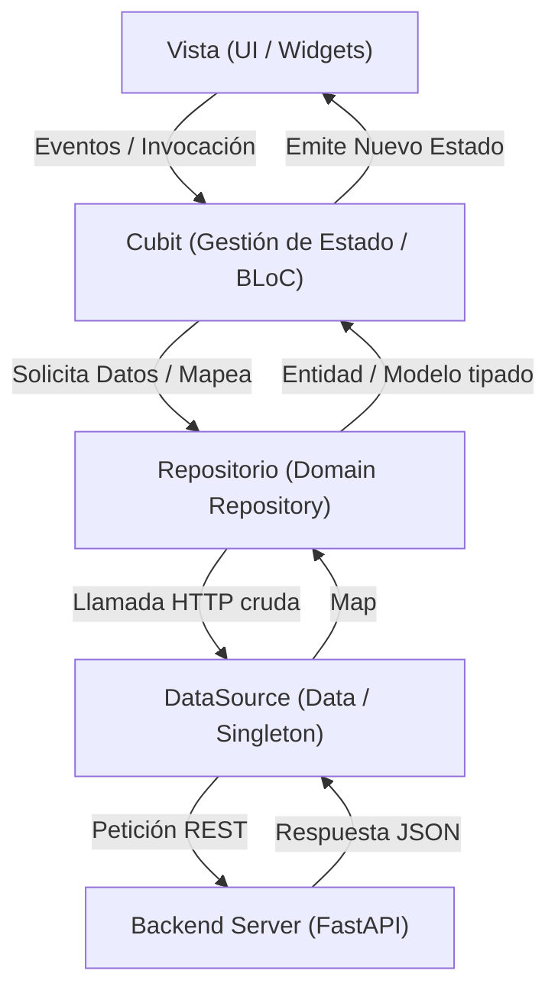

# Índice General del Proyecto y Guía de Arquitectura (`wiki/project_index.md`)

Bienvenido a la documentación arquitectónica y técnica de **Kardex App Front**. 

> **Navegación rápida para agentes**
>
> - 🧭 [`INDEX.md`](./INDEX.md) — hub: estructura, dónde está cada cosa y catálogo de enlaces.
> - 🧱 [`conventions.md`](./conventions.md) — capas, naming, UI y verificación.
> - 🔐 [`security.md`](./security.md) — sesión, permisos y guards.
> - ⚙️ [`operations.md`](./operations.md) — ejecución, defines y builds.
> - 🗂️ [`modules/modules_index.md`](./modules/modules_index.md) — catálogo de módulos.
>
> Este documento sigue siendo la referencia de la **arquitectura Onion / BLoC** y del ciclo de vida global.

> [!IMPORTANT]
> **Lectura Obligatoria:** Cualquier desarrollador o agente de Inteligencia Artificial que trabaje en esta aplicación **DEBE leer [`INDEX.md`](./INDEX.md) antes de realizar cualquier acción, análisis o modificación de código**.

> [!IMPORTANT]
> **Regla de ediciones `main` / `lite`:** todo cambio realizado en `main` debe evaluarse explícitamente para `lite` antes de darse por terminado. Consulta el flujo y las reglas en [ramas_main_vs_lite.md](./ramas_main_vs_lite.md#8-reglas-para-desarrollo-y-mantenimiento).

---

## 1. Visión General del Proyecto

`kardex_app_front` es la aplicación cliente multiplataforma (Web, Windows Desktop, Android Tablet y Móvil) desarrollada en **Flutter**, diseñada para la gestión empresarial integral de inventarios multi-sucursal, facturación comercial (POS y crédito), logística de traslados, cuentas por cobrar, tesorería y reportes financieros.

Se comunica con una API REST construida en **FastAPI / Python (`kardex-server`)**, respaldada por MongoDB.

---

## 2. Patrón Arquitectónico Fundamental (Onion + BLoC/Cubit)

La base del código sigue estrictamente una arquitectura desacoplada por capas:



### Reglas por Capa:
1. **Modelos (`packages/kardex_business/lib/src/domain/models/`):**
   - Entidades inmutables fuertemente tipadas.
   - Proveen métodos `fromJson()`, `toJson()` y `copyWith()`.
   - **Regla:** No contienen lógica de llamadas de red ni estado mutable.
2. **DataSources (`packages/kardex_business/lib/src/data/`):**
   - Clases con `with HttpService` (se instancian en `lib/provider_container.dart`).
   - Utilizan `HttpTools.generateUri(_endpoint)` y `HttpTools.generateAuthHeaders()`.
   - **Regla:** Retornan únicamente `Map<String, dynamic>`. No conocen los modelos de dominio.
3. **Repositorios (`packages/kardex_business/lib/src/domain/repositories/`):**
   - Representan la fuente de verdad en memoria de la aplicación.
   - Reciben los mapas crudos de los DataSources y los transforman en modelos de dominio mediante `.fromJson()`.
   - Manejan caché local en memoria cuando aplica y notifican mediante reactividad (`ReactiveRepository`).
4. **Cubits (`lib/src/modules/<modulo>/.../cubit/` o `lib/cubits/`):**
   - Extienden de `Cubit<TState>`.
   - Reciben el Repositorio inyectado o vía `context.read<TRepository>()`.
   - Manejan estados específicos (ej. `Initial`, `Loading`, `Loaded`, `Error`).
   - Nunca realizan peticiones HTTP directas ni invocan DataSources directamente.
5. **Vistas / UI (`lib/src/modules/<modulo>/.../` o `lib/widgets/`):**
   - Widgets declarativos (`StatelessWidget` o `StatefulWidget`).
   - Consumen los Cubits mediante `BlocProvider`, `BlocBuilder`, `BlocConsumer` o `context.watch<TCubit>()`.
   - Separan interfaces responsivas por plataforma (`web/`, `mobile/`, `tablet/`, `desktop/`).

---

## 3. Estructura del Árbol de Directorios (`lib/`)

```text
lib/
├── config/                      # Configuraciones globales
│   ├── app_env.dart             # Variables de entorno y endpoints base
│   ├── app_router.dart          # Router declarativo GoRouter con guardas
│   ├── app_theme.dart           # Sistema de diseño, paleta de colores y estilos
│   ├── get_it_config.dart       # Contenedor de Inyección de Dependencias
│   └── scroll_behavior.dart     # Soporte de scroll táctil y puntero
├── constants/                   # Constantes del sistema
│   ├── route_names.dart         # Nombres canónicos de rutas
│   └── shortcut_registry.dart   # Registro global de atajos de teclado
├── cubits/                      # Cubits globales (AuthCubit, AppModeCubit, AppSettingsCubit, ShortcutsCubit, ToastCubit)
├── src/
│   ├── core/                    # AccessManager, SessionManager, config y borradores
│   ├── modules/                 # Módulos de funcionalidad y pantallas
│   ├── services/                # thermal_printer_service.dart
│   └── tools/                   # Utilidades (extensiones, formatters, printers, exportadores)
├── widgets/                     # Widgets y componentes globales reutilizables
│   ├── design_system/           # Tokens, botones, cards y estados
│   ├── dialogs/                 # Modales, visores y selectores globales
│   ├── gates/                   # Control de acceso por roles (RolePermissionGate)
│   ├── pdf/                     # Plantillas imprimibles PDF A4
│   └── tables/                  # Componentes de tablas interactivas
├── main.dart                    # Bootstrap principal de la aplicación
├── material_app_builder.dart    # Configuración de MaterialApp.router y atajos globales
└── provider_container.dart      # MultiBlocProvider e inyección de Repositorios en el árbol

packages/kardex_business/lib/src/
├── data/                        # DataSources (*_data_source.dart)
├── domain/
│   ├── models/                  # Modelos y DTOs
│   ├── repositories/            # Repositorios y caché
│   ├── query_params/            # Filtros tipados
│   └── responses/               # Envolturas de respuesta (ListResponse, etc.)
├── services/                    # http_service.dart, dio_http_service.dart
└── tools/                       # TokenManager, ReactiveRepository, utilidades
```

> `lib/src/data/` **no existe** y `lib/src/domain/` está vacío: la capa de datos/dominio vive en `packages/kardex_business`.

---

## 4. Ciclo de Vida y Flujo Global

1. **Bootstrap (`main.dart` -> `SplashScreen`):**
   - Inicializa el almacenamiento local con Hive.
   - Comprueba la validez de la sesión JWT y el estado de la licencia comercial.
2. **Selección de Sucursal (`multi_branch_home` vs `home`):**
   - Si el usuario tiene acceso a más de una sucursal, se le presenta la pantalla de selección multi-sucursal.
   - El estado de la sucursal activa se mantiene en `AppModeCubit`.
   - **Regla `isCommerce`:** Si la sucursal activa tiene `isCommerce: false`, el router y el menú principal bloquean de inmediato el acceso a los módulos de ventas y cobranzas.
3. **Inyección de Dependencias (`provider_container.dart`):**
   - Los repositorios y cubits globales se inyectan en el tope del árbol de widgets para estar disponibles en cualquier parte de la jerarquía visual mediante `context.read<T>()`.

---

## 5. Índice de Documentación Modular

Para conocer a detalle la lógica, vistas, cubits y repositorios de cada módulo funcional, consulta:

- 🎨 **[Identidad Visual y Guía de Estilos (diseno_e_identidad_visual.md)](./diseno_e_identidad_visual.md)** - Reglas arquitectónicas de fondos (`Colors.indigo.shade50`), contraste con tarjetas Bento blancas, AppBar corporativo (`#072A3C`) y erradicación de fondos blancos planos.
- 🗺️ **[Sistema de Navegación y Arquitectura (sistema_navegacion.md)](./sistema_navegacion.md)** - Guía maestra de navegación: Split Hub (Desktop), Drill-Down (Mobile), permisos de roles, fallback seguro y diferencias entre ramas `main` y `lite`.
- 🧭 **[Ediciones main vs lite (ramas_main_vs_lite.md)](./ramas_main_vs_lite.md)** - Contexto de negocio: por qué existe `lite`, el flujo simplificado de producto/stock/precio y por qué no incluye movimientos de kárdex.
- 📋 **[Índice de Módulos (modules_index.md)](./modules/modules_index.md)** - Resumen ejecutivo de todos los módulos.
- 🛒 **[Comercial (modules/commercial.md)](./modules/commercial.md)** - Terminal POS, facturas, recibos, proformas y devoluciones.
- 📋 **[Notas de Crédito (modules/credit_notes.md)](./modules/credit_notes.md)** - Sustitución y evolución de devoluciones (por devolución o monto), patrón de Repositorio Reactivo (`ReactiveRepository`) y amortización en recibos.
- 📦 **[Inventario (modules/inventory.md)](./modules/inventory.md)** - Stock, entradas/salidas (kárdex y directo), transferencias y ajustes.
- 🏷️ **[Catálogo de Productos (modules/product_catalog.md)](./modules/product_catalog.md)** - Productos, códigos alternativos, categorías, unidades de medida y escalas de conversión.
- ⚖️ **[Escalas de Unidades (modules/unit_scales.md)](./modules/unit_scales.md)** - Plantillas de conversión estandarizadas (Peso, Volumen, Longitud, Tiempo y personalizadas) para agilizar la parametrización de productos.
- 💳 **[Cuentas Pendientes (modules/pending_accounts.md)](./modules/pending_accounts.md)** - Cuentas por cobrar y pagos de facturas.
- 📊 **[Finanzas (modules/finance.md)](./modules/finance.md)** - Cierres diarios, arqueos de caja y reportes ejecutivos.
- 💸 **[Gastos (modules/expenses.md)](./modules/expenses.md)** - Gastos operativos y a proveedores.
- 👥 **[Catálogo de Clientes (modules/client_catalog.md)](./modules/client_catalog.md)** - Clientes, límites de crédito y mapa.
- 🚚 **[Catálogo de Proveedores (modules/suppliers_catalog.md)](./modules/suppliers_catalog.md)** - Abastecedores y condiciones de compra.
- ⚙️ **[Configuración (modules/settings.md)](./modules/settings.md)** - Sucursales, roles, periféricos, parámetros globales del sistema (`app_settings`) y precios.
- 📥 **[Importaciones CSV (modules/imports.md)](./modules/imports.md)** - Carga masiva de inventario inicial, inventario, clientes y proveedores con plantillas descargables.
- 🚀 **[Navegación y Acceso (modules/home_and_navigation.md)](./modules/home_and_navigation.md)** - Login, multi-sucursal y atajos de teclado.
- 📈 **[Herramientas Avanzadas (modules/advanced_tools.md)](./modules/advanced_tools.md)** - Estadísticas y proyecciones.
- 🖨️ **[Sistema de Impresión Térmica Directa (sistema_impresion_termica.md)](./sistema_impresion_termica.md)** - Arquitectura de impresión Bluetooth/USB sin drivers externos, rasterización ESC/POS, tramado Floyd-Steinberg y post-mortems de incidencias.
