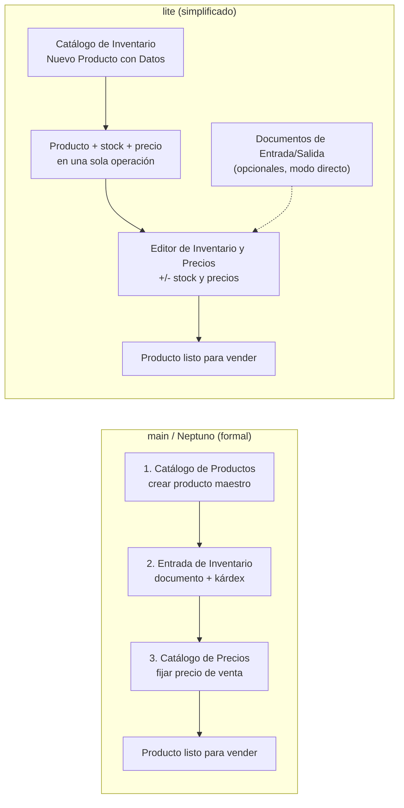

# Ediciones `main` vs `lite`: Contexto de Negocio y Reglas de Producto (`wiki/ramas_main_vs_lite.md`)

> [!IMPORTANT]
> Este documento explica **por qué** existen las dos ediciones de Kardex App Front (Neptuno App) y qué decisiones de producto hay detrás. La **matriz técnica** de navegación, rutas y módulos está en [sistema_navegacion.md](./sistema_navegacion.md#6-matriz-de-diferencias-entre-ramas-main-vs-lite). Este documento no duplica esa matriz: la interpreta desde el negocio.

---

## 1. Resumen ejecutivo

Kardex App Front se distribuye en dos ediciones sobre el mismo backend:

| Edición | Nombre comercial | Enfoque | Cliente objetivo |
| :--- | :--- | :--- | :--- |
| `main` | Neptuno / Estándar | Control formal y trazabilidad completa | Empresas medianas/grandes con procesos de inventario, auditoría y contabilidad |
| `lite` | Lite / Ligera | Operación simplificada de producto, stock y precio | Comercios pequeños/medianos con poca capacitación y necesidad de rapidez |

**Idea central:** `lite` no es "`main` con menos botones". Es una edición con un modelo operativo distinto: prioriza **hacer rápido las tres cosas básicas** (crear producto, cargar stock y fijar precio) sobre la trazabilidad formal del kárdex.

---

## 2. El problema que originó `lite`

En `main`, el flujo mínimo para dejar un producto listo para vender tiene tres pasos y tres pantallas distintas:

1. **Crear el producto** en el Catálogo de Productos (datos maestros: nombre, marca, unidad, categoría, etc.).
2. **Darle entrada al inventario** mediante un documento de Entrada de Inventario, para que exista stock y costo.
3. **Fijar el precio de venta** en el Catálogo de Precios de la sucursal.

Para un cliente pequeño o mediano, ese recorrido se percibe como complicado: son tres conceptos (producto, documento, precio) y tres lugares diferentes para una sola intención de negocio ("quiero vender este artículo"). El cliente no ve un flujo, ve una secuencia de módulos.

La hipótesis de `lite` fue: **si el usuario puede crear el producto, cargar la cantidad y poner el precio en un solo lugar, la adopción mejora y se reduce la capacitación.**

---

## 3. Cómo responde `lite`: el Catálogo de Inventario

`lite` concentra la operación diaria en el **Catálogo de Inventario** (`product-inventory-catalog`), dentro del módulo de Inventario.

### 3.1. Alta de producto en un solo formulario

Desde el botón **+** del catálogo se abre **"Nuevo Producto con Datos"**. En un solo formulario se captura:

- Nombre, marca, código, código alternativo, palabras clave, categoría, unidad de medida e imagen.
- **Cantidad Inicial**, **Costo Unitario** y **Precio Venta**.
- IVA, estado activo y unidades extra/escalas.

El sistema crea el producto y su información de inventario/precio para la sucursal en una sola operación. Ya no hace falta crear el producto y luego "ir a darle entrada" y "luego ir a ponerle precio".

### 3.2. Edición directa de stock y precio

Al tocar un producto del catálogo se abre el **"Editor de Inventario y Precios"**, que reúne:

- **Agregar al inventario**: cantidad, costo unitario y, si aplica, fecha de vencimiento.
- **Restar al inventario**: cantidad a descontar.
- **Precios de venta (1 a 4 niveles)**, con precio equivalente por unidad extra (caja, docena, etc.) y guardado directo.
- **Margen automático por unidad** cuando `AppSettings.useDefaultProfitMargin` está activo.
- **Comparativa de costos** (promedio, última compra y máximo) en unidad base y en la unidad seleccionada.
- **Editar Producto**: acceso al formulario maestro para corregir datos, incluidas las unidades y escalas.
- Indicadores de existencia y alerta si el precio queda por debajo del costo.

Este editor es la pieza que reemplaza, para el día a día, la combinación de "documento de entrada + catálogo de precios" de `main`.

### 3.3. Los documentos siguen existiendo

`lite` **no elimina** la Entrada/Salida de Inventario ni sus historiales. Si el cliente quiere dejar un comprobante formal, puede hacerlo. La diferencia es que en `lite` esos documentos se procesan en **modo directo** (`useKardex: false`): actualizan stock y costos, pero no generan asientos en el libro kárdex.

---

## 4. Flujo comparado

---

## 5. Por qué no existe "Movimientos de un Producto" en `lite`

Esta es la duda más frecuente y la más importante de documentar.

En `main`, la opción **"Movimientos de un Producto"** consulta el **libro kárdex**: los asientos que se generan cuando una entrada, salida, ajuste, transferencia o venta afecta el inventario con costo promedio ponderado. Es una pantalla de auditoría.

En `lite`, las operaciones de stock no escriben ese libro:

- El **+/- del editor** llama directamente a `addProductAccount` / `substractProductAccount`, que actualizan la cuenta del producto en la sucursal (existencia y costo).
- La **Entrada/Salida** se crea con `useKardex: false`, por lo que el cubit deriva a `createNewEntryDocDirect` / `createNewExitDocDirect`.
- No se generan transacciones de kárdex.

Por eso la pantalla de movimientos **no tiene fuente de datos que mostrar**. No está rota ni "pendiente": se omitió deliberadamente para no ofrecer una auditoría vacía o engañosa. Si algún día `lite` necesita kárdex, el cambio no es habilitar el menú: implica cambiar el modelo de registro de movimientos y la lógica de costos.

---

## 6. Qué conserva `lite`

Aunque simplifica el flujo principal, `lite` mantiene las herramientas operativas que el cliente sigue necesitando:

- Inventario Actual y consultas de existencias.
- Entrada y Salida de Inventario, con sus historiales (en modo directo).
- Historial de Entradas por Producto.
- Transferencias entre sucursales.
- Bitácora de Vencimientos (si la sucursal/configuración lo habilita).
- Catálogo de Productos como sección dentro de Inventario (lista global, categorías, unidades y escalas).
- Comercio, Cuentas por Cobrar, Gastos, Finanzas, Clientes, Proveedores y Configuración.

Lo que `lite` **no** incluye: Movimientos de un Producto (kárdex), Ajustes y Mermas, y Herramientas Avanzadas (proyecciones/estadísticas).

---

## 7. Cómo decidir entre `main` y `lite`

| Si el cliente... | Recomendar |
| :--- | :--- |
| Necesita kárdex, costo promedio ponderado y auditoría de cada movimiento | `main` |
| Maneja ajustes, mermas y conteos con trazabilidad formal | `main` |
| Usa documentos formales como parte de su control interno | `main` |
| Requiere proyecciones, rotación y herramientas avanzadas | `main` |
| Es un comercio pequeño/mediano y quiere crear producto, cargar stock y poner precio rápido | `lite` |
| Tiene poco personal o poca capacitación y prioriza simplicidad | `lite` |
| No necesita auditoría de kárdex, solo control básico de existencias | `lite` |
| Quiere documentos solo como respaldo ocasional, no como proceso central | `lite` |

**Regla práctica:** si la primera pregunta del cliente es "¿puedo ver el kárdex de este producto?", va a `main`. Si la primera pregunta es "¿cómo cargo un producto y le pongo precio rápido?", va a `lite`.

---

## 8. Reglas para desarrollo y mantenimiento

1. **`lite` no es un feature flag de `main`.** Son dos modelos operativos. No asumas que una mejora de `main` aplica igual en `lite`.
2. **No habilitar `product-movements` en `lite` sin implementar kárdex.** La pantalla quedaría vacía porque no hay asientos que leer.
3. **No portar el editor directo de stock a `main` sin evaluar el kárdex.** En `main`, el flujo formal y la auditoría son parte del valor del producto.
4. **Mantener los documentos en `lite`.** Aunque sean directos, siguen siendo el respaldo operativo del cliente.
5. **Revisar ambas ramas ante cualquier cambio de navegación.** La matriz técnica y las reglas están en [sistema_navegacion.md](./sistema_navegacion.md#7-guía-práctica-para-desarrolladores), sección 7.3.
6. **Actualizar este documento si cambia el flujo de producto/stock/precio.** La documentación debe explicar la intención, no solo la pantalla.

---

## 9. Referencias de implementación

| Tema | Rama | Referencia |
| :--- | :--- | :--- |
| Catálogo de Inventario | `lite` | `lib/src/modules/inventory/product_inventory_catalog/product_inventory_catalog_screen.dart` |
| Editor de Inventario y Precios | `lite` | `lib/widgets/dialogs/product_inventory_editor_dialog.dart` |
| Alta "Nuevo Producto con Datos" | `lite` (invocado) | `lib/widgets/dialogs/create_product_with_data_dialog.dart` |
| Sumar/restar stock | `lite` | `lib/src/cubits/write_product_account/write_product_account_cubit.dart` |
| Entrada/Salida en modo directo | `lite` | `write_entry_doc_cubit.dart` / `write_exit_doc_cubit.dart` con `useKardex: false` |
| Movimientos de un Producto | `main` | Módulo `inventory/product_movements` y ruta `product-movements` |
| Catálogo de Precios | `main` | `lib/src/modules/inventory/product_price_catalog/` y ruta `product-price-catalog` |

---

*Documento de contexto de producto. Para la especificación técnica de navegación, consulta [sistema_navegacion.md](./sistema_navegacion.md).*
