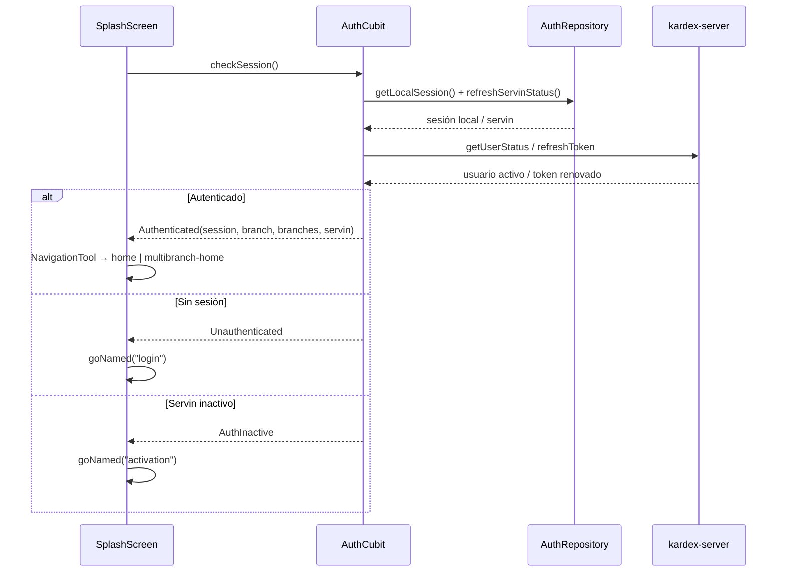

# Seguridad, Sesión y Permisos (`kardex_app_front`)

Cómo se autentica la app, dónde se guarda la sesión, cómo se resuelven permisos y qué guards existen en la navegación.

> **Principio:** el frontend **no es** la frontera de seguridad. Los guards de UI son experiencia de usuario; la autorización real la aplica `kardex-server`. No asumas que ocultar un botón protege un endpoint.

---

## 1. Flujo de autenticación



Puntos clave:

- `AuthCubit.checkSession()` valida sesión local, estado del servin, estado del usuario y expiración del token.
- Si el token está cerca de expirar, se refresca antes de continuar.
- Si el usuario está inactivo, se emite `Unauthenticated`.
- `SplashScreen` decide la primera ruta según el estado.

Archivos:

- `lib/cubits/auth/auth_cubit.dart` y `auth_state.dart`
- `lib/src/modules/splash/splash_screen.dart`
- `lib/src/tools/navigation_tool.dart`

---

## 2. Sesión y token

| Elemento | Ubicación | Detalle |
| :--- | :--- | :--- |
| Almacenamiento de sesión | `lib/src/core/session_manager.dart` | Hive, caja `sessionBox`, clave `session` (JSON). |
| Configuración persistida | `lib/src/core/app_config_manager.dart` | Hive, caja `config_box`. |
| Token JWT | `packages/kardex_business/lib/src/tools/token_manager.dart` | Lectura/validación de expiración. |
| Inyección del token | `lib/src/core/app_kardex_config.dart` | `authToken` desde `TokenManager`. |

> Hive no cifra por defecto. Si el despliegue lo requiere, evalúa `HiveAesCipher` y el manejo de la clave. No agregues secretos adicionales al almacenamiento local sin revisar este punto.

---

## 3. Permisos y roles

### `AccessManager`

`lib/src/core/access_manager.dart`:

- `user.id == 'root'` → acceso total.
- `user.userRole.access.contains(permissionName)` → permiso explícito.
- `access.contains("all")` → comodín.
- `hasCurrentAccess(context, permissionName)` lee el `AuthCubit` actual.

### `RolePermissionGate`

`lib/widgets/gates/role_permission_gate.dart`:

- `PermissionMode.whitelist` → muestra el hijo si **algún** permiso coincide.
- `PermissionMode.blacklist` → muestra el hijo si **ningún** permiso coincide.
- Permite `fallback` para un estado alternativo.

```dart
RolePermissionGate(
  permissions: [Modules.commercial],
  child: const CommercialMenuButton(),
)
```

Los permisos se declaran como enums en
`packages/kardex_business/lib/src/domain/models/user_role/modules.dart`
(`Modules`, `CommercialSubModules`, etc.).

---

## 4. Guards de navegación

`lib/config/app_router.dart` **no** tiene un redirect global de autenticación. La protección se reparte así:

| Guard | Dónde | Efecto |
| :--- | :--- | :--- |
| Estado de sesión | `SplashScreen` + `AuthCubit` | Redirige a `login`, `activation` o `inactive`. |
| `isCommerce` | `app_router.dart` (comercial y cuentas pendientes) | Si la sucursal no es comercial, redirige a `/home`. |
| Feature flags | `app_router.dart` (escalas de unidades) | Redirige a la pestaña permitida si `SHOW_UNIT_SCALES=false`. |
| Permisos de UI | `RolePermissionGate` / `AccessManager` | Oculta o reemplaza widgets. |

> Las pantallas operativas se abren a pantalla completa. Si agregas una ruta nueva, decide explícitamente si necesita guard de sesión, de `isCommerce` o de permisos.

> [!WARNING]
> **Los guards y las rutas pueden diferir entre `main` y `lite`.** Antes de asumir que una pantalla está protegida o disponible, verifica la edición activa (`git branch --show-current`), si la ruta está comentada en `app_router.dart` y si el módulo aparece en `home_modules_registry.dart`. Ver [`ramas_main_vs_lite.md`](./ramas_main_vs_lite.md).

---

## 5. Sucursal y multi-tenant

- La sucursal activa vive en `AuthCubit.currentBranch` y en `AppModeCubit`.
- `AppKardexConfig` propaga `servinNickname` y `branchId` a las peticiones de `kardex_business`.
- `kOriginBranchId` identifica la sucursal de origen cuando aplica.
- `NavigationTool.getNavigationAuthenticatedDestination` decide entre `home` y `multibranch-home`:

| Condición | Destino |
| :--- | :--- |
| `!servin.isMultiBranch` | `home` |
| `isMultiBranch` y rol `Admin` | `multibranch-home` |
| Resto | `home` |

- **Regla `isCommerce`:** una sucursal con `isCommerce: false` no debe acceder a ventas ni cobranzas. El router lo bloquea; si agregas una ruta comercial, replica el guard.

---

## 6. Recomendaciones al tocar auth/permisos

- [ ] ¿El endpoint del backend también valida el permiso? Si no, el cambio es solo cosmético.
- [ ] ¿La ruta nueva tiene el guard de sesión/`isCommerce` que corresponde?
- [ ] ¿Los permisos nuevos se agregaron al enum `Modules` y al rol por defecto?
- [ ] ¿El `RolePermissionGate` tiene un `fallback` sensato (no una pantalla en blanco)?
- [ ] ¿El cambio aplica a `lite`? (los permisos y rutas pueden diferir).
- [ ] ¿Evitaste guardar secretos o tokens en logs?

---

## 7. Secretos

- `secrets.json`, `secrets_dev.json` y `secrets_prod.json` están en `.gitignore`.
- No imprimas su contenido en logs ni lo pegues en la wiki.
- `scripts/compile_web.py` y `scripts/compile_web_lite.py` contienen tokens de Netlify embebidos; trátalos como credenciales y no los reproduzcas en documentación.
