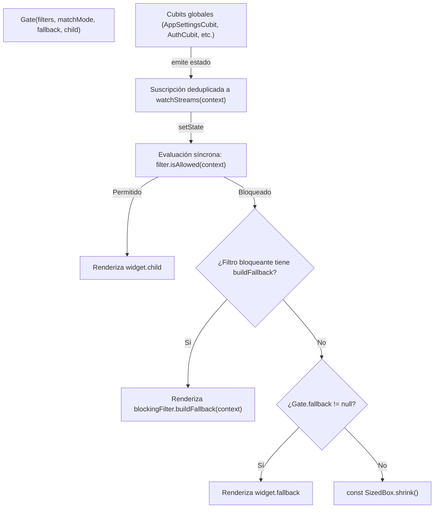

# Sistema Unificado de `Gate` y `GateFilter` (`wiki/sistema_gates.md`)

Guía técnica de referencia sobre cómo funcionan los widgets de control de acceso y visibilidad condicional en **Kardex App Front**, tanto en la rama `main` como en `lite`.

> [!NOTE]
> Los `Gate` son controles de **visibilidad y experiencia de usuario** en el frontend. La autorización real de cada operación siempre la valida `kardex-server`. Ver [`security.md`](./security.md).

---

## 1. Filosofía y Patrón de Diseño

En lugar de crear un widget independiente por cada bandera o regla de negocio (`OrdersGate`, `QuotationsGate`, `RolePermissionGate`, etc.) y anidarlos en el árbol de widgets, la aplicación utiliza **un único widget `Gate`** que recibe una lista plana de filtros (`List<GateFilter>`), de forma análoga a `inputFormatters` (`List<TextInputFormatter>`) en `TextField`.

```dart
Gate(
  filters: const [
    OrdersGateFilter(),
    RolePermissionGateFilter(
      permissions: [CommercialSubModules.orders],
    ),
  ],
  child: const OrdersMenuCard(),
)
```

### Ventajas del enfoque
1. **Árbol plano:** sin importar cuántas condiciones protejan un widget, en el árbol solo existe **un** nodo `Gate`.
2. **Composición declarativa:** las reglas se combinan en listas (`const [...]`) y con combinadores (`AnyGateFilter`, `NotGateFilter`, `PredicateGateFilter`).
3. **Reutilización fuera de la UI:** cada `GateFilter` expone `isAllowed(BuildContext)`, por lo que el mismo filtro que protege un widget en pantalla sirve para evaluaciones síncronas (como [`HomeShortcutResolver`](../lib/src/modules/home/data/home_shortcut_resolver.dart)).
4. **Extensibilidad:** agregar una nueva condición requiere únicamente crear una subclase de `GateFilter`, sin modificar `Gate` ni `HomeSubmoduleItem`.

---

## 2. Arquitectura y Flujo Reactivo



### 2.1. Widget `Gate` (`lib/widgets/gates/gate.dart`)

`Gate` es un `StatefulWidget` con los siguientes parámetros:

| Parámetro | Tipo | Por defecto | Descripción |
| :--- | :--- | :--- | :--- |
| `filters` | `List<GateFilter>` | *requerido* | Lista de filtros a evaluar. Si está vacía, permite el acceso. |
| `child` | `Widget` | *requerido* | Contenido a mostrar cuando se cumple la condición. |
| `matchMode` | `GateMatchMode` | `GateMatchMode.all` | `all` exige que pasen **todos** los filtros (AND); `any` exige que pase **al menos uno** (OR). |
| `fallback` | `Widget?` | `null` | Widget alternativo si ningún filtro bloqueante define uno propio. Si es `null`, renderiza `const SizedBox.shrink()`. |
| `width` / `height` | `double?` | `null` | Si se especifican, envuelve el resultado en un `SizedBox` con esas dimensiones. |

**Detalles internos importantes:**
- **Deduplicación de streams:** en `didChangeDependencies()` (y en `didUpdateWidget()` solo cuando cambia la lista de filtros), `_GateState` recolecta en un `Set<Stream<Object?>>` los streams retornados por `watchStreams(context)` de cada filtro y crea una única suscripción por stream único.
- **Compatibilidad con `Expanded` / `Flexible`:** cuando `width == null && height == null`, `Gate.build` retorna directamente `widget.child` (o el fallback) sin envolverlo en un `RenderObjectWidget` adicional. Esto permite usar `Gate(child: Expanded(...))` o `Gate(child: Flexible(...))` directamente dentro de `Row` o `Column`.
- **Prioridad de `fallback`:** en modo `GateMatchMode.all`, los filtros se evalúan en orden y el **primer filtro que retorna `false`** puede aportar su propio `buildFallback(context)`. Si retorna `null`, se usa `Gate.fallback`, y en último caso `const SizedBox.shrink()`.

### 2.2. Contrato `GateFilter` (`lib/widgets/gates/gate_filter.dart`)

```dart
abstract class GateFilter {
  const GateFilter();

  bool isAllowed(BuildContext context);

  Iterable<Stream<Object?>> watchStreams(BuildContext context) => const [];

  Widget? buildFallback(BuildContext context) => null;
}
```

- `isAllowed(context)`: evalúa de forma síncrona si el contenido debe mostrarse.
- `watchStreams(context)`: declara qué streams deben disparar una re-evaluación automática en `Gate`. Si un filtro es puramente estático o síncrono, puede omitir este método.
- `buildFallback(context)`: permite asociar un fallback específico a un filtro concreto (útil cuando distintos motivos de bloqueo muestran mensajes diferentes, como en [`ImportsScreen`](../lib/src/modules/imports/imports_screen.dart)).

---

## 3. Catálogo de Filtros Disponibles

Todos los filtros se exportan desde [`lib/widgets/gates/gates.dart`](../lib/widgets/gates/gates.dart) y también están re-exportados en [`lib/widgets/widgets.dart`](../lib/widgets/widgets.dart).

### 3.1. Filtros de Dominio (`lib/widgets/gates/filters/`)

| Clase | Archivo | Qué evalúa | Streams observados |
| :--- | :--- | :--- | :--- |
| `RolePermissionGateFilter` | `role_permission_gate_filter.dart` | Permisos del rol activo mediante `AccessManager`. Soporta `PermissionMode.whitelist` (algún permiso coincide) y `PermissionMode.blacklist` (ningún permiso coincide). | `AuthCubit.stream` |
| `RootUserGateFilter` | `root_user_gate_filter.dart` | Verifica que el usuario autenticado sea `user.id == 'root'`. | `AuthCubit.stream` |
| `ExpirationDateGateFilter` | `expiration_date_gate_filter.dart` | Verifica `Authenticated`, `servin.isUsingExpirationDate == true` y `AppSettingsCubit.useExpirationDates == true`. | `AuthCubit.stream`, `AppSettingsCubit.stream` |
| `OrdersGateFilter` | `orders_gate_filter.dart` | Verifica `AppSettingsCubit.useOrders == true`. | `AppSettingsCubit.stream` |
| `QuotationsGateFilter` | `quotations_gate_filter.dart` | Verifica `AppSettingsCubit.useQuotations == true`. | `AppSettingsCubit.stream` |
| `ShiftsGateFilter` | `shifts_gate_filter.dart` | Verifica `AppSettingsCubit.useShifts == true`. | `AppSettingsCubit.stream` |

> Todos los filtros anteriores verifican `getIt.isRegistered<T>()` antes de resolver cubits globales y aceptan inyección opcional por constructor (`authCubit`, `appSettingsCubit`, `accessManager`) para facilitar pruebas unitarias aisladas.

### 3.2. Combinadores y Filtros Genéricos (`lib/widgets/gates/gate_filter.dart`)

| Clase | Uso | Ejemplo |
| :--- | :--- | :--- |
| `AnyGateFilter` | OR lógico entre varios filtros (pasa si al menos uno pasa). | `AnyGateFilter([QuotationsGateFilter(), OrdersGateFilter()])` |
| `NotGateFilter` | Invierte el resultado de otro filtro. | `NotGateFilter(RootUserGateFilter())` |
| `PredicateGateFilter` | Condición ad-hoc inline con `predicate` y `watch` opcional. | `PredicateGateFilter((ctx) => isReady)` |

---

## 4. Casos de Uso Comunes

### Múltiples condiciones en un botón de menú (AND)
```dart
Gate(
  filters: const [
    OrdersGateFilter(),
    RolePermissionGateFilter(
      permissions: [CommercialSubModules.orders],
    ),
  ],
  child: MenuOptionCard(...),
)
```

### Condición OR dentro de una lista AND
```dart
Gate(
  filters: const [
    AnyGateFilter([
      QuotationsGateFilter(),
      OrdersGateFilter(),
    ]),
    RolePermissionGateFilter(
      permissions: [CommercialSubModules.orders],
    ),
  ],
  child: MenuOptionCard(...),
)
```

### Fallbacks diferenciados por motivo de bloqueo (ejemplo `ImportsScreen`)
```dart
Gate(
  filters: [
    RootUserGateFilter(
      fallback: const Center(child: Text("Solo el usuario root puede acceder.")),
    ),
    RolePermissionGateFilter(
      permissions: const [Modules.settings],
      fallback: const Center(child: Text("No tienes permisos.")),
    ),
  ],
  child: const _ImportsView(),
)
```

### Integración con `HomeSubmoduleItem`
En [`home_modules_registry.dart`](../lib/src/modules/home/data/home_modules_registry.dart), cada submódulo declara sus reglas en `gates`:

```dart
const HomeSubmoduleItem(
  section: "Cotizaciones y Proformas",
  title: "Cotizaciones",
  icon: Icons.manage_search,
  routeName: "quotation-order-search",
  gates: [
    AnyGateFilter([QuotationsGateFilter(), OrdersGateFilter()]),
    RolePermissionGateFilter(permissions: [CommercialSubModules.orders]),
  ],
)
```

Con esa única definición:
- [`DesktopSubmenuPanel`](../lib/src/modules/home/view/desktop/widgets/desktop_submenu_panel.dart) envuelve la tarjeta en `Gate(filters: item.gates, child: card)`.
- [`HomeShortcutResolver`](../lib/src/modules/home/data/home_shortcut_resolver.dart) valida los accesos directos con `item.gates.every((filter) => filter.isAllowed(context))`.

---

## 5. Cómo Agregar un Nuevo `GateFilter`

1. Crea el archivo en `lib/widgets/gates/filters/<nombre>_gate_filter.dart` extendiendo `GateFilter` con constructor `const`:

```dart
import 'package:kardex_app_front/config/get_it_config.dart';
import 'package:kardex_app_front/cubits/app_settings/app_settings_cubit.dart';
import 'package:kardex_app_front/widgets/gates/gate_filter.dart';
import 'package:material_ui/material_ui.dart';

class HoldSalesGateFilter extends GateFilter {
  const HoldSalesGateFilter({this.fallback, this.appSettingsCubit});

  final Widget? fallback;
  final AppSettingsCubit? appSettingsCubit;

  AppSettingsCubit? _resolveCubit() {
    if (appSettingsCubit != null) return appSettingsCubit;
    return getIt.isRegistered<AppSettingsCubit>()
        ? getIt<AppSettingsCubit>()
        : null;
  }

  @override
  bool isAllowed(BuildContext context) {
    return _resolveCubit()?.useHoldSales ?? false;
  }

  @override
  Iterable<Stream<Object?>> watchStreams(BuildContext context) {
    final cubit = _resolveCubit();
    return cubit != null ? [cubit.stream] : const [];
  }

  @override
  Widget? buildFallback(BuildContext context) => fallback;
}
```

2. Expórtalo en [`lib/widgets/gates/gates.dart`](../lib/widgets/gates/gates.dart).
3. Agrega pruebas unitarias/widget en [`test/gate_test.dart`](../test/gate_test.dart).
4. Si aplica a ambas ediciones (`main` y `lite`), implementa en `main` y sincroniza hacia `lite` con `git merge main`.
