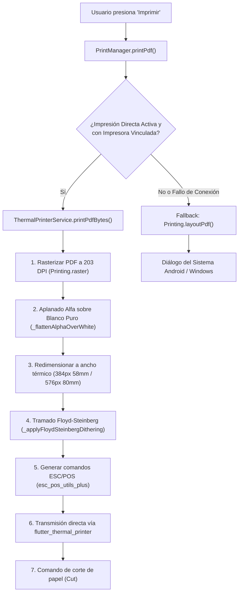

# Sistema de Impresión Térmica Directa (`wiki/sistema_impresion_termica.md`)

Este documento detalla la arquitectura, decisiones de diseño, problemas críticos resueltos (*post-mortems*) y mejores prácticas del sistema de **impresión térmica directa** en `kardex_app_front`.

---

## 1. Contexto y Motivación: ¿Por qué se hizo este cambio?

### La Situación Anterior
Anteriormente, la aplicación utilizaba el método `Printing.layoutPdf(...)` de la librería `printing`. Este método delegaba la impresión al **Administrador de Impresión nativo del Sistema Android (Android Print Spooler)**.
- **Limitación de Android:** El sistema operativo Android no incluye controladores integrados para impresoras térmicas de tickets (ESC/POS) que se conectan por Bluetooth, USB o Red.
- **Dependencia de Apps de Terceros:** Para que Android pudiera comunicarse con una impresora térmica portátil o de mostrador, el usuario final estaba obligado a instalar y configurar aplicaciones externas de la Play Store como **Open ESC/POS** o **RawBT Print Service**.
- **Fricción Operativa:** Cada impresión requería abrir el diálogo del sistema Android, seleccionar la impresora manualmente y confirmar con un toque adicional, lo cual resultaba lento e ineficiente para el ritmo de un punto de venta (POS).

### El Objetivo
Eliminar el 100% de la dependencia de aplicaciones y controladores externos, permitiendo que la propia app `kardex_app_front` se comunique de forma directa, nativa, en **1 solo clic (*silent print*)** e instantánea con impresoras térmicas Bluetooth y USB, manteniendo un mecanismo de respaldo (*fallback*) seguro al diálogo del sistema.

---

## 2. Arquitectura del Sistema



### Componentes Clave:
1. **[`ThermalPrinterService`](../lib/src/services/thermal_printer_service.dart):**
   - Servicio Singleton registrado en `GetIt` (`lib/config/get_it_config.dart`) e inicializado en `main.dart`.
   - Gestiona permisos de Bluetooth (`BLUETOOTH_SCAN`, `BLUETOOTH_CONNECT`) y Ubicación mediante `permission_handler`.
   - Controla el escaneo en tiempo real de dispositivos Bluetooth y USB (`devicesStream`).
   - Implementa el pipeline de procesamiento de imágenes: aplanado de transparencias, redimensionado divisible por 8, tramado Floyd-Steinberg y fragmentación en bloques de 30 px para proteger los buffers de hardware de las impresoras.
2. **[`PrintManager`](../lib/src/tools/printers/print_manager.dart):**
   - Capa de orquestación y persistencia local en Hive (`LocalPrintSettings`):
     - `paperSize`: Ancho configurado (`58mm` u `80mm`).
     - `isDirectPrintEnabled`: Interruptor de impresión directa.
     - `savedThermalPrinter`: Objeto JSON de la impresora vinculada (dirección MAC/IP, nombre, tipo de conexión).
     - `autoCutEnabled`: Corte automático de papel.
     - `invertColorEnabled`: Inversión de polaridad (blanco/negro).
     - `ditheringEnabled`: Tramado de alta fidelidad para gráficos.
   - Provee el método centralizado `printPdf(...)` con *fallback* transparente al spooler del sistema en caso de desconexión o fallo.
3. **[`LocalPrinterSettingsDialog`](../lib/src/modules/settings/view/local_printer_settings_dialog.dart):**
   - Interfaz de usuario para buscar dispositivos cercanos, vincular/desvincular impresoras, alternar opciones de hardware y ejecutar páginas de prueba (*self-test*).
4. **Impresores Específicos:**
   - [`invoice_printer.dart`](../lib/src/tools/printers/invoice_printer.dart), [`order_printer.dart`](../lib/src/tools/printers/order_printer.dart), [`receipt_printer.dart`](../lib/src/tools/printers/receipt_printer.dart), [`devolution_printer.dart`](../lib/src/tools/printers/devolution_printer.dart), [`cash_counter_ticket_printer.dart`](../lib/src/tools/printers/cash_counter_ticket_printer.dart) delegan directamente en `PrintManager.printPdf(...)`.

---

## 3. Registro de Bugs Críticos, Causas Raíz y Soluciones (*Post-Mortems*)

Durante el diseño y pruebas físicas de esta solución se identificaron problemas técnicos de alta relevancia que fueron resueltos:

---

### ⚠️ Bug 1: La impresión salía completamente quemada en negro (Página 100% negra)

* **Síntoma:** Al enviar cualquier documento a la impresora física, salía una tira continua de papel térmico completamente negra y quemada de borde a borde.
* **Causa Raíz:**
  1. `Printing.raster()` genera las páginas del documento PDF con **fondo transparente** (`RGBA = 0, 0, 0, 0`) para optimizar tamaño.
  2. El generador térmico de `esc_pos_utils_plus` (`_toRasterFormat`) ejecuta un comando `invert(image)` para invertir los colores (en un ticket blanco, el texto negro `0` debe convertirse en `255` para activar el pulso de calor en el cabezal).
  3. `esc_pos_utils_plus` ignora por completo el canal alfa (transparencia). Por lo tanto, al leer el fondo transparente cuyo valor RGB es `(0, 0, 0)`, lo invertía a `(255, 255, 255)`.
  4. Al binarizar los datos (`valor > 127 = quemar punto`), el 95% del papel que debía ser blanco se interpretaba como punto activo, enviando ráfagas continuas de bytes `0xFF` al cabezal.
* **Solución Implementada:**
  - En `ThermalPrinterService`, se creó la función `_flattenAlphaOverWhite()`:
    ```dart
    img.Image _flattenAlphaOverWhite(img.Image src) {
      final canvas = img.Image(width: src.width, height: src.height, numChannels: 4);
      img.fill(canvas, color: img.ColorRgba8(255, 255, 255, 255));
      img.compositeImage(canvas, src);
      for (final pixel in canvas) {
        if (pixel.a < 255) {
          final alpha = pixel.a / 255.0;
          pixel.r = (pixel.r * alpha + 255 * (1 - alpha)).round();
          pixel.g = (pixel.g * alpha + 255 * (1 - alpha)).round();
          pixel.b = (pixel.b * alpha + 255 * (1 - alpha)).round();
          pixel.a = 255;
        }
      }
      return canvas;
    }
    ```
  - Al forzar un fondo blanco puro (`255`), la inversión de ESC/POS lo transforma en `0` (cabezal inactivo / papel blanco intacto) y únicamente las letras o trazos negros (`0`) se invierten a `255` (punto térmico activo).

---

### ⚠️ Bug 2: El logo salía borroso, roto o con partes invisibles (Pérdida de tonos grises)

* **Síntoma:** En logos con figuras en color gris o degradados (por ejemplo, el logo del sistema con un planeta gris claro, anillo negro y hexágono interior negro), el cuerpo del planeta se borraba por completo, imprimiéndose solo el anillo y el hexágono flotando en el vacío.
* **Causa Raíz:**
  1. Las impresoras térmicas solo pueden imprimir en **blanco y negro binario puro** (no disponen de tinta gris ni niveles de calor variables por píxel).
  2. `esc_pos_utils_plus` aplicaba un **corte rígido (*hard threshold*) fijo en 127**:
     - Brillo $\le 127 \rightarrow$ Negro.
     - Brillo $> 127 \rightarrow$ Blanco.
  3. El color gris del planeta en el logo original tiene una luminosidad de **~136 sobre 255**.
  4. Al ser $136 > 127$, el algoritmo lo clasificaba inmediatamente como fondo blanco, eliminando todo el sombreado del planeta.
* **Solución Implementada:**
  - Se implementó el algoritmo estándar de la industria gráfica: **Tramado por Difusión de Error (Floyd-Steinberg Dithering / Halftone)** en `_applyFloydSteinbergDithering()`:
    ```dart
    img.Image _applyFloydSteinbergDithering(img.Image image) {
      final width = image.width;
      final height = image.height;
      final errors = Float32List(width * height);
      // Cargar luminosidad
      for (var i = 0; i < width * height; i++) {
        errors[i] = image.getPixel(i % width, i ~/ width).r.toDouble();
      }
      // Difusión de error de Floyd-Steinberg (7/16, 3/16, 5/16, 1/16)
      for (var y = 0; y < height; y++) {
        for (var x = 0; x < width; x++) {
          final idx = y * width + x;
          final oldVal = errors[idx];
          final newVal = oldVal < 128.0 ? 0.0 : 255.0;
          final err = oldVal - newVal;
          final colorVal = newVal.toInt();
          image.setPixelRgb(x, y, colorVal, colorVal, colorVal);
          if (x + 1 < width) errors[idx + 1] += err * (7.0 / 16.0);
          if (y + 1 < height) {
            if (x - 1 >= 0) errors[(y + 1) * width + (x - 1)] += err * (3.0 / 16.0);
            errors[(y + 1) * width + x] += err * (5.0 / 16.0);
            if (x + 1 < width) errors[(y + 1) * width + (x + 1)] += err * (1.0 / 16.0);
          }
        }
      }
      return image;
    }
    ```
  - **Resultado:** El gris del planeta se traduce en una fina matriz de micro-puntos térmicos que el ojo humano interpreta como sombra uniforme, preservando el contraste con el hexágono negro y el anillo exterior con fidelidad fotográfica.
  - Se ejecuta en **< 75 milisegundos** en memoria, sin ralentizar la impresión.

---

### ⚠️ Bug 3: Incompatibilidad de Dependencias en Windows con `win32`

* **Síntoma:** Al agregar `flutter_thermal_printer: ^2.3.0`, el comando `flutter pub get` fallaba debido a que exigía `win32 ^6.4.0`, mientras que la dependencia existente `share_plus: ^12.0.2` utilizaba `win32 ^5.5.3`.
* **Causa Raíz:** Conflicto de versiones mayores en el paquete transitorio de Windows.
* **Solución Implementada:**
  - Se fijó la dependencia en `flutter_thermal_printer: 2.0.1`, compatible con `win32 ^5.x.x` y completamente estable con la versión actual de Flutter.

---

### ⚠️ Bug 4: Ambigüedad de Tipos con la Clase `Printer`

* **Síntoma:** Error de compilación en Dart: *The name 'Printer' is defined in the libraries 'package:flutter_thermal_printer/utils/printer.dart' and 'package:printing/src/printer.dart'*.
* **Causa Raíz:** Ambos paquetes exportaban una clase homónima `Printer`.
* **Solución Implementada:**
  - Ocultar la clase de `printing` en los archivos que consumen ambos paquetes:
    ```dart
    import 'package:printing/printing.dart' hide Printer;
    ```

---

## 4. Guía de Uso para el Usuario Final

1. **Acceso:** Ir al menú lateral o menú de opciones $\rightarrow$ **Configuración** $\rightarrow$ **Configuración de Impresora Local**.
2. **Seleccionar Formato:** Elegir entre **80 mm (Estándar)** o **58 mm (Compacto)**.
3. **Activar Impresión Térmica Directa:** Activar el interruptor *"Impresión Térmica Directa (1 Clic)"*.
4. **Buscar Dispositivos:** Pulsar el botón **"Buscar"**. La app solicitará permisos de Bluetooth y escaneará los dispositivos cercanos.
5. **Vincular:** Pulsar **"Vincular"** en la impresora detectada.
6. **Probar:** Pulsar el botón **"Probar Impresión"** para emitir un ticket de prueba y comprobar la conexión física.
7. **Guardar:** Pulsar **"Guardar"**. A partir de ese momento, todas las facturas, pedidos, recibos, arqueos y devoluciones se imprimirán en silencio directamente en esa impresora térmica.
