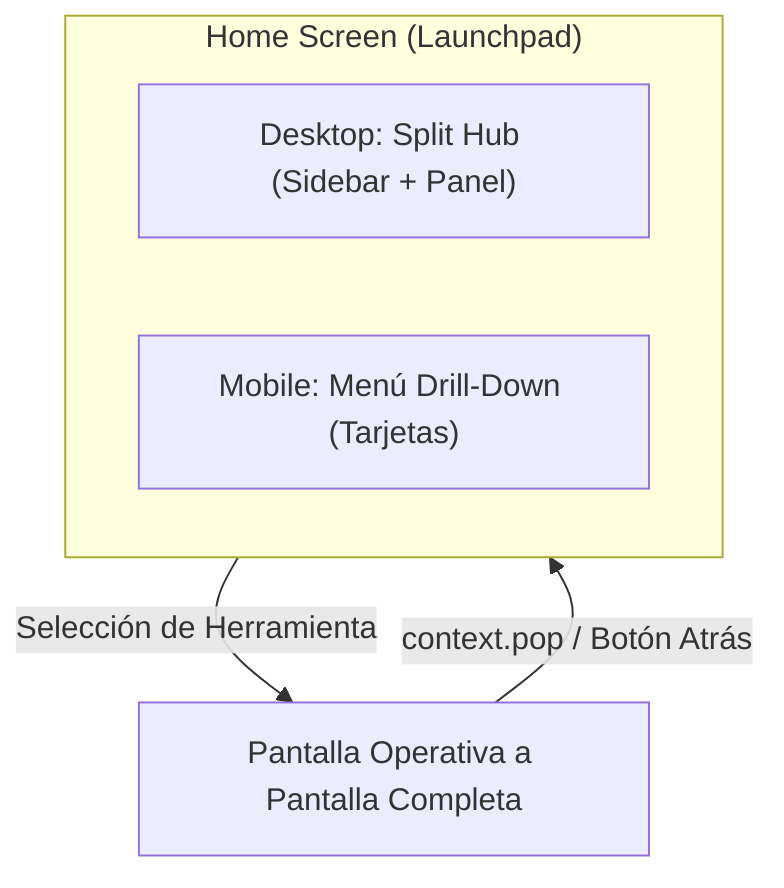
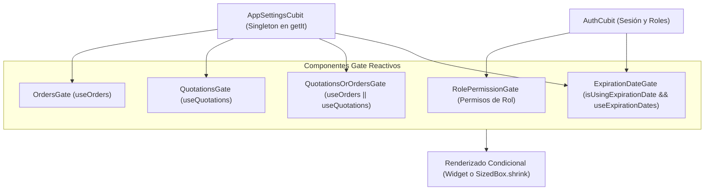

# Sistema de Navegación: Guía de Arquitectura y Referencia Completa (`wiki/sistema_navegacion.md`)

Este documento constituye la fuente de verdad y la especificación técnica exhaustiva sobre cómo funciona la navegación en **Kardex App Front** (**Neptuno App**), tanto en la rama estándar (`main`) como en la rama ligera (`lite`).

---

## 1. Filosofía y Paradigma de Navegación

### 1.1. Enfoque "Hub de Lanzamiento" (Launchpad) vs. "Barras Persistentes"
A diferencia de sistemas convencionales con sidebars persistentes en todas las pantallas, en Kardex App Front la navegación opera bajo el concepto de **Launchpad Central**:
1. **El Home es el Hub:** Tanto en escritorio como en móvil, el Home sirve exclusivamente para localizar, filtrar y lanzar herramientas de trabajo.
2. **Pantalla Completa Operativa (Full-Screen Mode):** Al hacer clic en cualquier herramienta (POS, facturación, kardex, traslados, etc.), la vista seleccionada se abre ocupando el 100% del ancho y alto de la pantalla con su propio `AppBar` y botón de retroceso (`context.pop()`).
3. **Justificación Ergonómica:** Las operaciones comerciales e industriales (como el escaneo continuo en el POS, edición de tablas masivas de inventario, o dashboards financieros) requieren la máxima área horizontal posible sin interferencias visuales ni barras laterales que resten espacio a los datos.



---

## 2. Arquitectura Responsiva y Puntos de Quiebre (Breakpoints)

El sistema detecta automáticamente las dimensiones de la pantalla del dispositivo mediante las extensiones `context.isMobile()`, `context.isTablet()` y `context.isDesktop()` definidas en `lib/src/tools/extensiones.dart`:

| Dispositivo / Ancho | Breakpoint | Componente en `HomeScreen` | Comportamiento |
| :--- | :---: | :--- | :--- |
| **Móvil** | `< 600 dp` | `_HomeMobileBody` | Flujo vertical drill-down con tarjetas táctiles `MenuOptionCard`. Al pulsar un módulo, navega a su submenú correspondiente. |
| **Tablet** | `600 - 839 dp` | `_HomeTabletBody` | Cuadrícula fluida compacta con tarjetas adaptables. |
| **Escritorio / Web** | `≥ 840 dp` | `_HomeDesktopBody` | **Split Hub adaptativo de 2 columnas:** Sidebar vertical izquierdo fijo + Panel derecho con buscador en tiempo real y tarjetas agrupadas. |

---

## 3. Componentes Visuales del Sistema de Navegación

Todos los componentes de navegación están estandarizados en `lib/widgets/` y en `lib/src/modules/home/view/desktop/widgets/`:

### 3.1. Componentes de Escritorio
- **`DesktopModuleSidebar` (`lib/.../desktop/widgets/desktop_module_sidebar.dart`):**
  - Ancho fijo de 280 dp.
  - Encabezado con información de la sucursal activa (`currentBranch`), dirección e indicador circular online verde (`#10B981`).
  - Lista de módulos con iconos temáticos redondeados, títulos legibles y distintivo de estado activo (borde de 1 dp y fondo con opacidad del color temático).
  - Contador de módulos en la cabecera.
- **`DesktopSubmenuPanel` (`lib/.../desktop/widgets/desktop_submenu_panel.dart`):**
  - Panel derecho con fondo neutro suave (`#F8FAFC`).
  - Cabecera con icono grande (48x48 dp), título del módulo, subtítulo explicativo y distintivo de conteo.
  - Buscador reactivo en tiempo real integrado en la cabecera con botón para limpiar búsqueda.
  - Contenedor ergonómico centrado con ancho máximo de 960 dp (`ConstrainedBox(maxWidth: 960)`).
  - Agrupación estructurada de opciones por secciones temáticas con `MenuSectionDivider`.
- **`DesktopSubmenuCard` (`lib/.../desktop/widgets/desktop_submenu_card.dart`):**
  - Tarjeta interactiva con elevación sutil, borde suave (`#E2E8F0`), microanimación de hover y desplazamiento horizontal del chevron.
  - Icono acentuado en caja cuadrada redondeada (42x42 dp) tintada con el color temático.

### 3.2. Componentes Móviles y Compartidos
- **`MenuOptionCard` (`lib/widgets/cards/menu_option_card.dart`):**
  - Sustituto universal de los antiguos `ListTile` planos.
  - Fondo blanco, radio redondeado de 14 dp, borde tenue `Colors.grey.shade200` y sombra suave.
  - Contenedor de icono (46x46 dp) tintado al 10% del color temático.
  - Tipografía jerárquica: Título en negrita (14.5 dp) y subtítulo conciso (12 dp, gris tenue).
  - Compatible al 100% con `ShortcutAddableListTile` (detección de pulsación prolongada para accesos directos).
- **`MenuSectionDivider` (`lib/widgets/dividers/menu_section_divider.dart`):**
  - Divisor de secciones con título en mayúsculas tenues (`11.5 dp`, `FontWeight.w700`, `letterSpacing: 0.9`, `Colors.grey.shade600`) y línea divisoria horizontal.
  - Parámetro `isFirst` para ajustar el margen superior en la primera sección de una lista.
- **`TertiaryMenuButton` (`lib/widgets/buttons/tertiary_menu_button.dart`):**
  - Botón plano de texto/icono sin borde para `AppBar` o barras oscuras (fondo `#072a3c`).
  - Esquinas redondeadas (12 dp), densidad compacta y sin el margen invisible de 48 dp de Flutter (`MaterialTapTargetSize.shrinkWrap`).

---

## 4. Registro Centralizado de Módulos (`home_modules_registry.dart`)

Toda la estructura de navegación está centralizada en `lib/src/modules/home/data/home_modules_registry.dart`. Este archivo actúa como el catálogo maestro que alimenta al Split Hub de escritorio.

### 4.1. Modelos de Datos
```dart
enum HomeModuleId {
  clients,
  suppliers,
  products,        // Solo en rama main
  commercial,
  pendingAccounts,
  inventory,
  expenses,
  finance,
  advancedTools,   // Solo en rama main
  settings,
}

class HomeSubmoduleItem {
  final String title;
  final String? subtitle;
  final IconData icon;
  final Color? accentColor;
  final String? routeName;
  final void Function(BuildContext context)? customAction;
  final List<Enum> permissions;
  final bool isExpirationGate;
  final String? section;
  // ...
}

class HomeModuleCategory {
  final HomeModuleId id;
  final String title;
  final String subtitle;
  final IconData icon;
  final Color accentColor;
  final List<Modules> permissions;
  final bool isCommerceOnly;
  final String mobileRoute;
  final List<HomeSubmoduleItem> submodules;
  // ...
}
```

---

## 5. Reglas de Negocio, Dinamismo y Seguridad

### 5.1. Orden Fijo y Predecible
El orden de los módulos en el Sidebar de Escritorio es **fijo e idéntico al de Móvil y Tablet**:
1. 👤 **Clientes**
2. 🏢 **Proveedores**
3. 📦 **Catálogo de Productos** *(Solo en rama `main`)*
4. 🛒 **Comercio** *(Condicionado por `isCommerce`)*
5. 💳 **Cuentas por Cobrar** *(Condicionado por `isCommerce`)*
6. 🗃️ **Inventario** *(En `lite` integra el catálogo de productos aquí)*
7. 📉 **Gastos**
8. 📈 **Finanzas**
9. 🔮 **Herramientas Avanzadas** *(Solo en rama `main`)*
10. ⚙️ **Configuraciones**

### 5.2. Condición por Tipo de Sucursal (`isCommerce`)
Cada sucursal registrada en el sistema tiene un indicador booleano `isCommerce`:
- **Sucursal Comercial (`isCommerce == true`):** Muestra el icono de tienda en ámbar (`FluentIcons.building_shop_24_filled`), activa el módulo de **Comercio** y el de **Cuentas por Cobrar**.
- **Bodega / Almacén (`isCommerce == false`):** Muestra el icono de bodega en azul pizarra (`Icons.warehouse_rounded`), y **oculta automáticamente** los módulos de Comercio y Cuentas por Cobrar tanto en Desktop como en Mobile.

### 5.3. Selección Inicial Segura del Primer Módulo (`allowedCategories.first`)
Al cargar `_HomeDesktopBody`, el sistema calcula:
```dart
final allowedCategories = allCategories.where((cat) {
  return cat.permissions.any(
    (p) => AccessManager().hasCurrentAccess(context, p.name),
  );
}).toList();

final activeId = _selectedModuleId != null &&
        allowedCategories.any((c) => c.id == _selectedModuleId)
    ? _selectedModuleId!
    : allowedCategories.first.id;
```
- **Seguridad Garantizada:** Si un usuario inicia sesión con un rol restringido (por ejemplo, un cajero que no tiene acceso a Clientes ni Proveedores), `allowedCategories.first` resuelve automáticamente al primer módulo permitido (en este caso, **Comercio**).
- **Nunca abre un módulo no autorizado por defecto.**
- Si el usuario no tiene permisos en ningún módulo, se renderiza una vista de advertencia: *"No tienes permisos asignados para acceder a los módulos de esta sucursal"*.

### 5.4. Sistema de Gates Reactivos y Filtrado de Opciones (`AppSettingsCubit`)

El sistema cuenta con una arquitectura de protección y filtrado multinivel mediante componentes **Gate** reactivos suscritos a los cubits globales:



1. **Inyección y Precarga Global:**
   - `AppSettingsCubit` se instancia y registra como Singleton en `getIt` dentro de `ProviderContainer` (idéntico a `AuthCubit`), y se provee en el árbol de widgets mediante `BlocProvider.value`.
   - Se precarga automáticamente en `SplashScreen` (`getIt<AppSettingsCubit>().loadSettings()`) en paralelo con la verificación de sesión `checkSession()`.
2. **`RolePermissionGate`:**
   - Evalúa los permisos del rol activo contra `AccessManager().hasCurrentAccess(context, p.name)`. Si el rol carece del permiso, retorna `const SizedBox.shrink()`.
3. **`OrdersGate` (`lib/widgets/gates/orders_gate.dart`):**
   - Se suscribe reactivamente a `AppSettingsCubit`.
   - Si `useOrders == false`, oculta automáticamente las opciones de creación y seguimiento de órdenes de compra tanto en el panel de escritorio como en el menú móvil.
4. **`QuotationsGate` y `QuotationsOrOrdersGate` (`lib/widgets/gates/quotations_gate.dart`):**
   - Oculta reactivamente las opciones de proformas/cotizaciones (`useQuotations == false`).
   - `QuotationsOrOrdersGate` protege herramientas híbridas (como el buscador conjunto de órdenes y cotizaciones) mostrándolas si al menos una de las dos banderas está encendida.
   - En escritorio, el divisor de sección `MenuSectionDivider` de *Cotizaciones y Proformas* se envuelve en `QuotationsGate` para ocultar la sección completa si está deshabilitada.
5. **`ExpirationDateGate` (`lib/widgets/gates/expiration_date_gate.dart`):**
   - Combina la validación de servidor (`authState.servin.isUsingExpirationDate`) con la bandera global del sistema (`getIt<AppSettingsCubit>().useExpirationDates`).
   - Si cualquiera es falsa, oculta las opciones de bitácoras de vencimiento y columnas de lotes.
6. **Banderas en `HomeSubmoduleItem` (`home_modules_registry.dart`):**
   - Los elementos del catálogo maestro cuentan con las banderas booleanas `isExpirationGate`, `isOrdersGate`, `isQuotationsGate` e `isQuotationsOrOrdersGate`, aplicadas de forma declarativa y procesadas automáticamente por `DesktopSubmenuPanel`.

---

## 6. Matriz de Diferencias entre Ramas: `main` vs. `lite`

| Característica | Rama `main` (Estándar) | Rama `lite` (Ligera) |
| :--- | :--- | :--- |
| **Módulos Raíz en Home / Sidebar** | 10 módulos disponibles | 8 módulos disponibles |
| **Catálogo de Productos** | Módulo raíz independiente (`HomeModuleId.products`) | Integrado como la primera sección dentro de **Inventario** |
| **Herramientas Avanzadas** | Módulo raíz independiente (`Modules.advancedTools`) con proyecciones y estimación | Totalmente deshabilitado (no figura en sidebar ni en `app_router.dart`) |
| **Inventario: Secciones** | 5 secciones: Consultas, Entradas/Salidas, Traslados, Precios, Ajustes/Mermas | 4 secciones: Catálogo, Consultas, Entradas/Salidas, Traslados |
| **Inventario: Catálogo** | Usa `product-price-catalog` (`RouteNames.productPriceCatalog`) | Usa `product-inventory-catalog` (`RouteNames.productInventoryCatalog`) con edición directa |
| **Inventario: Kárdex por Movimiento** | Opción activa `product-movements` | Deshabilitada (`product-movements` comentado) |
| **Inventario: Ajustes y Mermas** | Rutas activas (`adjust-entry`, `history-adjust-entry`, mermas) | Omitidas por completo (rutas no registradas en router) |
| **Comercio: Total de Opciones** | 28 opciones | 27 opciones (se omite `commercial-product-movements`) |
| **Condición de Pago Dinámica** | `SegmentedButton` en cotizaciones / órdenes borrador (`CONTADO`/`CRÉDITO`) | Idéntico (portado) |
| **Botones en AppBars Oscuros** | `TertiaryMenuButton` plano | Idéntico (portado) |

---

## 7. Guía Práctica para Desarrolladores

### 7.1. ¿Cómo agregar una nueva herramienta a un módulo existente?
1. Abre `lib/src/modules/home/data/home_modules_registry.dart`.
2. Ubica la categoría correspondiente dentro de `getHomeModuleCategories` (ej. `HomeModuleId.inventory`).
3. Agrega un nuevo `HomeSubmoduleItem` en el array `submodules`:
   ```dart
   HomeSubmoduleItem(
     section: "Existencias y Consultas", // Nombre de la sección temática
     title: "Mi Nueva Herramienta",
     subtitle: "Descripción concisa para la tarjeta",
     icon: Icons.auto_awesome,
     accentColor: const Color(0xFF0D9488),
     routeName: "mi-nueva-ruta",          // O customAction: (ctx) => ...
     permissions: [CommercialSubModules.miPermiso], // Omitir si no requiere rol específico
   ),
   ```
4. Agrega la tarjeta correspondiente en la pantalla móvil del submenú (ej. `inventory_menu_screen.dart`):
   ```dart
   ShortcutAddableListTile(
     routeName: RouteNames.miNuevaRuta,
     child: MenuOptionCard(
       icon: Icons.auto_awesome,
       accentColor: Colors.teal.shade600,
       title: "Mi Nueva Herramienta",
       subtitle: "Descripción concisa para la tarjeta",
       onTap: () => context.pushNamed("mi-nueva-ruta"),
     ),
   ),
   ```
5. Registra la ruta en `lib/config/app_router.dart` y en `lib/constants/route_names.dart`.

### 7.2. ¿Cómo agregar una acción modal interactiva (sin ruta)?
Utiliza la propiedad `customAction`:
```dart
HomeSubmoduleItem(
  title: "Consulta Rápida de Producto",
  subtitle: "Buscar precio y stock en pantalla",
  icon: Icons.info_outline,
  accentColor: const Color(0xFF2563EB),
  customAction: (ctx) => showProductInfoSearchDelegate(ctx),
),
```

### 7.3. Regla de Oro sobre las Ramas
Cualquier cambio que se realice en la navegación debe considerar las particularidades de `lite`:
- **Si agregas un módulo a `main`:** Evalúa si aplica a `lite` o si debe omitirse.
- **Si modificas `inventory_menu_screen.dart` en `main`:** Recuerda que en `lite` este archivo contiene la sección de *Catálogo de Productos* y carece de *Ajustes y Mermas*.
